# Project Architecture

This document provides a high-level overview of the wedding website's architecture. The project is a full-stack application built with Next.js, leveraging its capabilities for both client-side rendering and server-side Route Handlers.

## Core Components

The application is composed of three main parts:

1.  **Frontend:** A React-based user interface built with Next.js App Router.
2.  **Backend:** Serverless Route Handlers built with Next.js App Router.
3.  **Database:** A PostgreSQL database managed with Prisma ORM.

## Deployment Architecture & Single-Site Default

The default supported architecture is **one deployment = one wedding site**:
- **Single Canonical Config**: Every deployment loads a single canonical configuration (`id: "global"`).
- **Simplified Setup**: No wildcard DNS, tenant concepts, or subdomain routing are required for standard setups.
- **Provider-Neutral Host Filtering**: Strict host and `X-Forwarded-Host` validation prevents host header injection and HTTP host spoofing without binding site data to incoming Host headers.
- **Optional Multi-Site Module**: Multi-profile management and subdomain-based routing can be explicitly enabled via `MULTISITE_ENABLED=true` for advanced setups.

## Environment Specifications

For detailed runtime requirements, host configuration, environment variable specifications, and lifecycle expectations, see the authoritative [Application Runtime Contract](./docs/runtime-contract.md).

<!-- BEGIN AUTOGENERATED ENV -->
- **Node.js**: v22.x
- **Next.js**: ^16.4.2
- **React**: ^19.3.1
- **Prisma**: ^7.10.1
- **Zod**: ^4.6.7
<!-- END AUTOGENERATED ENV -->

```mermaid
graph TD
    subgraph Browser
        A[React Frontend]
    end

    subgraph Server (Node.js / Container Runtime)
        B[Next.js Route Handlers]
        C[Prisma Client]
    end

    subgraph Database [PostgreSQL Database]
        D[PostgreSQL]
    end

    A -- HTTP Requests --> B
    B -- Queries --> C
    C -- TCP Connection --> D
```

### 1. Frontend

The frontend is built using [Next.js](https://nextjs.org/) and [React](https://react.dev/). It is responsible for rendering the user interface that guests and administrators interact with.

-   **Location:** `src/app/`
-   **Key Technologies:**
    -   **React:** For building UI components.
    -   **Next.js:** For App Router, server-side rendering, and client-side navigation.
    -   **Tailwind CSS:** For styling.
    -   **Framer Motion:** For animations.
    -   **React Query:** For managing server state, caching, and data fetching.
-   **Structure:**
    -   **App Router (`src/app/`):** Uses the Next.js App Router where directories define the routes and `page.tsx` renders the UI.
    -   **Components (`src/components/`):** Reusable UI elements are located here.
    -   **Admin UI:** A separate set of pages and components under `src/app/admin/` provides an interface for managing the website.

```mermaid
flowchart LR
    classDef page fill:#0284c7,stroke:#0369a1,color:#ffffff,stroke-width:2px;
    classDef api fill:#4c1d95,stroke:#3b82f6,color:#ffffff,stroke-width:2px;

    App["src/app"]
    node_admin["admin"]
    node_admin_dashboard["dashboard"]
    node_admin_dashboard_attractions["attractions"]
    node_admin_dashboard_content["content"]
    node_admin_dashboard_history["history"]
    node_admin_dashboard_invitationcodes["invitation-codes"]
    node_admin_dashboard_maintenance["maintenance"]
    node_admin_dashboard_media["media"]
    node_admin_dashboard_seatingchart["seating-chart"]
    node_admin_dashboard_settings["settings"]
    node_admin_dashboard_sitemanager["site-manager"]
    node_admin_dashboard_subevents["sub-events"]
    node_admin_dashboard_thankyounotes["thank-you-notes"]
    node_admin_dashboard_weddingparty["wedding-party"]
    node_admin_login["login"]
    node_api["api"]
    node_api_admin["admin"]
    node_api_admin_entity["[entity]"]
    node_api_admin_entity_id["[id]"]
    node_api_admin_broadcast["broadcast"]
    node_api_admin_broadcast_history["history"]
    node_api_admin_broadcast_preview["preview"]
    node_api_admin_broadcast_retry["retry"]
    node_api_admin_broadcast_schedule["schedule"]
    node_api_admin_broadcast_schedule_id["[id]"]
    node_api_admin_broadcast_send["send"]
    node_api_admin_broadcast_testconnection["test-connection"]
    node_api_admin_features["features"]
    node_api_admin_invitationcodes["invitation-codes"]
    node_api_admin_invitationcodes_batch["batch"]
    node_api_admin_invitationcodes_batch_validate["validate"]
    node_api_admin_invitationcodes_export["export"]
    node_api_admin_invitationcodes_validate["validate"]
    node_api_admin_login["login"]
    node_api_admin_logout["logout"]
    node_api_admin_maintenance["maintenance"]
    node_api_admin_maintenance_export["export"]
    node_api_admin_maintenance_import["import"]
    node_api_admin_me["me"]
    node_api_admin_photos["photos"]
    node_api_admin_photos_id["[id]"]
    node_api_admin_photos_moderation["moderation"]
    node_api_admin_photos_moderation_batch["batch"]
    node_api_admin_sampledata["sample-data"]
    node_api_admin_seating["seating"]
    node_api_admin_seating_assign["assign"]
    node_api_admin_seating_export["export"]
    node_api_admin_settings["settings"]
    node_api_admin_setup["setup"]
    node_api_admin_subevents["sub-events"]
    node_api_admin_subevents_access["access"]
    node_api_admin_subevents_access_batch["batch"]
    node_api_admin_thankyounotes["thank-you-notes"]
    node_api_admin_thankyounotes_id["[id]"]
    node_api_admin_thankyounotes_batch["batch"]
    node_api_admin_thankyounotes_export["export"]
    node_api_admin_thankyounotes_exportlabels["export-labels"]
    node_api_admin_upload["upload"]
    node_api_admin_versions["versions"]
    node_api_admin_versions_id["[id]"]
    node_api_admin_versions_id_restore["restore"]
    node_api_cron["cron"]
    node_api_cron_broadcasts["broadcasts"]
    node_api_guest["guest"]
    node_api_guest_address["address"]
    node_api_guest_address_public["public"]
    node_api_guest_login["login"]
    node_api_guest_photos["photos"]
    node_api_guest_photos_upload["upload"]
    node_api_health["health"]
    node_api_media["media"]
    node_api_media_id["[id]"]
    node_api_media_export["export"]
    node_api_og["og"]
    node_api_photos["photos"]
    node_api_photos_upload["upload"]
    node_api_ready["ready"]
    node_api_registry["registry"]
    node_api_registry_contribute["contribute"]
    node_api_registry_items["items"]
    node_api_registry_items_id["[id]"]
    node_api_registry_scrape["scrape"]
    node_api_registry_session["session"]
    node_api_registry_validatecode["validate-code"]
    node_api_rsvp["rsvp"]
    node_api_schedule["schedule"]
    node_api_weather["weather"]
    node_archive["archive"]
    node_guest["guest"]
    node_guest_collect["collect"]
    node_guest_login["login"]
    node_heart["heart"]
    node_photos["photos"]
    node_projectinfo["project-info"]
    node_registry["registry"]
    node_registry_additem["add-item"]
    node_registry_edititem["edit-item"]
    node_registry_edititem_id["[id]"]
    node_thingstodo["things-to-do"]
    node_weather["weather"]
    node_weddingparty["wedding-party"]
    App --> node_admin
    node_admin --> node_admin_dashboard
    node_admin_dashboard --> node_admin_dashboard_attractions
    node_admin_dashboard --> node_admin_dashboard_content
    node_admin_dashboard --> node_admin_dashboard_history
    node_admin_dashboard --> node_admin_dashboard_invitationcodes
    node_admin_dashboard --> node_admin_dashboard_maintenance
    node_admin_dashboard --> node_admin_dashboard_media
    node_admin_dashboard --> node_admin_dashboard_seatingchart
    node_admin_dashboard --> node_admin_dashboard_settings
    node_admin_dashboard --> node_admin_dashboard_sitemanager
    node_admin_dashboard --> node_admin_dashboard_subevents
    node_admin_dashboard --> node_admin_dashboard_thankyounotes
    node_admin_dashboard --> node_admin_dashboard_weddingparty
    node_admin --> node_admin_login
    App --> node_api
    node_api --> node_api_admin
    node_api_admin --> node_api_admin_entity
    node_api_admin_entity --> node_api_admin_entity_id
    node_api_admin --> node_api_admin_broadcast
    node_api_admin_broadcast --> node_api_admin_broadcast_history
    node_api_admin_broadcast --> node_api_admin_broadcast_preview
    node_api_admin_broadcast --> node_api_admin_broadcast_retry
    node_api_admin_broadcast --> node_api_admin_broadcast_schedule
    node_api_admin_broadcast_schedule --> node_api_admin_broadcast_schedule_id
    node_api_admin_broadcast --> node_api_admin_broadcast_send
    node_api_admin_broadcast --> node_api_admin_broadcast_testconnection
    node_api_admin --> node_api_admin_features
    node_api_admin --> node_api_admin_invitationcodes
    node_api_admin_invitationcodes --> node_api_admin_invitationcodes_batch
    node_api_admin_invitationcodes_batch --> node_api_admin_invitationcodes_batch_validate
    node_api_admin_invitationcodes --> node_api_admin_invitationcodes_export
    node_api_admin_invitationcodes --> node_api_admin_invitationcodes_validate
    node_api_admin --> node_api_admin_login
    node_api_admin --> node_api_admin_logout
    node_api_admin --> node_api_admin_maintenance
    node_api_admin_maintenance --> node_api_admin_maintenance_export
    node_api_admin_maintenance --> node_api_admin_maintenance_import
    node_api_admin --> node_api_admin_me
    node_api_admin --> node_api_admin_photos
    node_api_admin_photos --> node_api_admin_photos_id
    node_api_admin_photos --> node_api_admin_photos_moderation
    node_api_admin_photos_moderation --> node_api_admin_photos_moderation_batch
    node_api_admin --> node_api_admin_sampledata
    node_api_admin --> node_api_admin_seating
    node_api_admin_seating --> node_api_admin_seating_assign
    node_api_admin_seating --> node_api_admin_seating_export
    node_api_admin --> node_api_admin_settings
    node_api_admin --> node_api_admin_setup
    node_api_admin --> node_api_admin_subevents
    node_api_admin_subevents --> node_api_admin_subevents_access
    node_api_admin_subevents_access --> node_api_admin_subevents_access_batch
    node_api_admin --> node_api_admin_thankyounotes
    node_api_admin_thankyounotes --> node_api_admin_thankyounotes_id
    node_api_admin_thankyounotes --> node_api_admin_thankyounotes_batch
    node_api_admin_thankyounotes --> node_api_admin_thankyounotes_export
    node_api_admin_thankyounotes --> node_api_admin_thankyounotes_exportlabels
    node_api_admin --> node_api_admin_upload
    node_api_admin --> node_api_admin_versions
    node_api_admin_versions --> node_api_admin_versions_id
    node_api_admin_versions_id --> node_api_admin_versions_id_restore
    node_api --> node_api_cron
    node_api_cron --> node_api_cron_broadcasts
    node_api --> node_api_guest
    node_api_guest --> node_api_guest_address
    node_api_guest_address --> node_api_guest_address_public
    node_api_guest --> node_api_guest_login
    node_api_guest --> node_api_guest_photos
    node_api_guest_photos --> node_api_guest_photos_upload
    node_api --> node_api_health
    node_api --> node_api_media
    node_api_media --> node_api_media_id
    node_api_media --> node_api_media_export
    node_api --> node_api_og
    node_api --> node_api_photos
    node_api_photos --> node_api_photos_upload
    node_api --> node_api_ready
    node_api --> node_api_registry
    node_api_registry --> node_api_registry_contribute
    node_api_registry --> node_api_registry_items
    node_api_registry_items --> node_api_registry_items_id
    node_api_registry --> node_api_registry_scrape
    node_api_registry --> node_api_registry_session
    node_api_registry --> node_api_registry_validatecode
    node_api --> node_api_rsvp
    node_api --> node_api_schedule
    node_api --> node_api_weather
    App --> node_archive
    App --> node_guest
    node_guest --> node_guest_collect
    node_guest --> node_guest_login
    App --> node_heart
    App --> node_photos
    App --> node_projectinfo
    App --> node_registry
    node_registry --> node_registry_additem
    node_registry --> node_registry_edititem
    node_registry_edititem --> node_registry_edititem_id
    App --> node_thingstodo
    App --> node_weather
    App --> node_weddingparty
    class App page;
    class node_admin_dashboard page;
    class node_admin_dashboard_attractions page;
    class node_admin_dashboard_content page;
    class node_admin_dashboard_history page;
    class node_admin_dashboard_invitationcodes page;
    class node_admin_dashboard_maintenance page;
    class node_admin_dashboard_media page;
    class node_admin_dashboard_seatingchart page;
    class node_admin_dashboard_settings page;
    class node_admin_dashboard_sitemanager page;
    class node_admin_dashboard_subevents page;
    class node_admin_dashboard_thankyounotes page;
    class node_admin_dashboard_weddingparty page;
    class node_admin_login page;
    class node_api_admin_entity api;
    class node_api_admin_entity_id api;
    class node_api_admin_broadcast_history api;
    class node_api_admin_broadcast_preview api;
    class node_api_admin_broadcast_retry api;
    class node_api_admin_broadcast_schedule_id api;
    class node_api_admin_broadcast_send api;
    class node_api_admin_broadcast_testconnection api;
    class node_api_admin_features api;
    class node_api_admin_invitationcodes_batch api;
    class node_api_admin_invitationcodes_batch_validate api;
    class node_api_admin_invitationcodes_export api;
    class node_api_admin_invitationcodes_validate api;
    class node_api_admin_login api;
    class node_api_admin_logout api;
    class node_api_admin_maintenance_export api;
    class node_api_admin_maintenance_import api;
    class node_api_admin_me api;
    class node_api_admin_photos_id api;
    class node_api_admin_photos_moderation api;
    class node_api_admin_photos_moderation_batch api;
    class node_api_admin_sampledata api;
    class node_api_admin_seating_assign api;
    class node_api_admin_seating_export api;
    class node_api_admin_settings api;
    class node_api_admin_setup api;
    class node_api_admin_subevents_access api;
    class node_api_admin_subevents_access_batch api;
    class node_api_admin_thankyounotes api;
    class node_api_admin_thankyounotes_id api;
    class node_api_admin_thankyounotes_batch api;
    class node_api_admin_thankyounotes_export api;
    class node_api_admin_thankyounotes_exportlabels api;
    class node_api_admin_upload api;
    class node_api_admin_versions api;
    class node_api_admin_versions_id_restore api;
    class node_api_cron_broadcasts api;
    class node_api_guest_address api;
    class node_api_guest_address_public api;
    class node_api_guest_login api;
    class node_api_guest_photos_upload api;
    class node_api_health api;
    class node_api_media api;
    class node_api_media_id api;
    class node_api_media_export api;
    class node_api_og api;
    class node_api_photos_upload api;
    class node_api_ready api;
    class node_api_registry_contribute api;
    class node_api_registry_items api;
    class node_api_registry_items_id api;
    class node_api_registry_scrape api;
    class node_api_registry_session api;
    class node_api_registry_validatecode api;
    class node_api_rsvp api;
    class node_api_schedule api;
    class node_api_weather api;
    class node_archive page;
    class node_guest page;
    class node_guest_collect page;
    class node_guest_login page;
    class node_heart page;
    class node_photos page;
    class node_projectinfo page;
    class node_registry page;
    class node_registry_additem page;
    class node_registry_edititem_id page;
    class node_thingstodo page;
    class node_weather page;
    class node_weddingparty page;
```

<!-- BEGIN AUTOGENERATED ROUTES -->


<!-- END AUTOGENERATED ROUTES -->

### 2. Backend (API)

The backend is a set of serverless functions implemented as Next.js Route Handlers. These routes handle business logic, data validation, and communication with the database.

- **Location:** `src/app/api/`
- **Key Technologies:**
  - **Next.js Route Handlers:** For creating serverless API endpoints.
  - **Prisma:** As the ORM for database access.
- **Route Groups:**
  - **Admin Routes (`src/app/api/admin/`):** Handle administrator authentication (`login`, `logout`, `me`, `setup`), feature flags, entity CRUD operations, email/SMS broadcasts (`send`, `history`, `preview`, `retry`, `schedule`, `test-connection`), invitation codes (`batch`, `export`, `validate`), seating assignments (`assign`, `export`), sub-events access management, thank-you notes (`batch`, `export`, `export-labels`), media uploads, version restoration, sample data seeding, and database maintenance (`export`, `import`).
  - **Cron Routes (`src/app/api/cron/`):** Provide scheduled serverless tasks, including `src/app/api/cron/broadcasts/` for executing pending email and SMS message delivery queues.
  - **Guest Routes (`src/app/api/guest/`):** Provide guest authentication (`login`), guest photo upload endpoints (`photos/upload`), and mailing address collection (`address` and `address/public`).
  - **Health Check Route (`src/app/api/health/`):** Server liveness probe returning HTTP 200 health status for infrastructure health monitoring and container orchestration.
  - **Media Routes (`src/app/api/media/`):** Resolve uploaded media assets by ID (`[id]`) and support bulk media file archive exports (`export`).
  - **Open Graph Route (`src/app/api/og/`):** Generate dynamic Open Graph social preview cards on the fly based on configuration branding settings.
  - **Photos Route (`src/app/api/photos/`):** Handle public guest photo gallery uploads (`upload`).
  - **Readiness Probe Route (`src/app/api/ready/`):** Server readiness probe checking database connectivity and system readiness before taking traffic.
  - **Registry Routes (`src/app/api/registry/`):** Manage gift registry items (`items`), guest contributions (`contribute`), invitation code validation (`validate-code`), guest contribution session management (`session`), and external product URL metadata scraping (`scrape`).
  - **RSVP Routes (`src/app/api/rsvp/`):** Handle guest RSVP submissions and invitation code lookups.
  - **Schedule Routes (`src/app/api/schedule/`):** Serve wedding event timeline items and sub-events filtered by guest access permissions.
  - **Weather Forecast Route (`src/app/api/weather/`):** Fetch live weather forecasts and conditions for the venue location.

### 3. Database

The database stores all application data using PostgreSQL managed via Prisma ORM.

- **Location:** The schema is defined in [prisma/schema.prisma](https://github.com/fderuiter/wedding_website/blob/HEAD/prisma/schema.prisma).
- **Key Technologies:**
  - **PostgreSQL:** Relational database implementing the project's standard database contract (compatible with local PostgreSQL, Neon, Supabase, Railway, AWS RDS, GCP Cloud SQL, etc. as labeled host examples).
  - **Prisma:** The ORM used to define the schema and interact with the database in a type-safe way.
- **Data Models:**
  - **`AppConfig`:** Stores global site settings, partner details, wedding date and venue parameters, visual theme tokens, feature toggles, and email/SMS broadcast provider credentials.
  - **`Media`:** Stores uploaded media metadata (URLs, alt text, decorative/sample flags) referenced by wedding party members, attractions, and registry items.
  - **`WeddingPartyMember`:** Represents members of the wedding party with name, role, bio, side (`BRIDE`, `GROOM`, `JOINT`), display order, and optional media relationship.
  - **`Attraction`:** Represents local attraction and accommodation recommendations, including categories, map coordinates, booking URLs, promo codes, and shuttle information.
  - **`RegistryItem`:** Represents gift registry items with item type, price, display order, quantity, group gift / most wanted flags, purchase status, and total contributed amount.
  - **`Contributor`:** Stores guest financial contributions towards registry items, including contributor contact info, contribution amounts, custom messages, and thank-you note status.
  - **`InvitationCode`:** Stores unique guest invitation passes, guest names, mailing addresses, dietary notes, plus-one allocations, party tags, assigned table references, and RSVP state.
  - **`SeatingTable`:** Stores reception seating tables with table name, shape, seat capacity, and floor plan coordinate attributes (`x`, `y`, `width`, `height`, `rotation`).
  - **`ContentNode`:** Provides dynamic CMS content storage for site copy, FAQ entries, announcements, and key-value JSON attributes tagged by domain.
  - **`SnapshotVersion`:** Stores audit logs and JSON entity snapshot history for change tracking and point-in-time state restoration.
  - **`SubEvent`:** Represents individual wedding schedule items (e.g., rehearsal dinner, ceremony, reception) with start/end times, venue details, and privacy settings.
  - **`SubEventAccess`:** Junction table defining explicit access permissions for private sub-events mapped to guest invitation codes.
  - **`SubEventRsvp`:** Stores guest RSVP responses for specific sub-events, including attendance status, plus-one counts, and dietary notes.
  - **`BroadcastMessage`:** Stores outbound email and SMS communication broadcasts, tracking target filters, delivery status, send timestamps, and dispatch counts.
  - **`BroadcastRecipient`:** Stores individual delivery logs for broadcast messages, recording destination addresses, delivery status, and error details.

The use of Prisma allows for easy schema management through migrations and provides a type-safe client for querying the database from the backend API. The project uses PostgreSQL as the sole active database layer for both local development and production.

### 4. Core Framework Infrastructure

To establish consistent data access, transaction management, state auditing, and session security across all application features, the codebase utilizes a centralized core framework layer located in `src/core/`.

#### Infrastructure Data Access Layer (`src/core/infrastructure/`)

- **`BaseRepository` ([src/core/infrastructure/repository.ts](https://github.com/fderuiter/wedding_website/blob/HEAD/src/core/infrastructure/repository.ts)):** The foundation for database interactions. It encapsulates standard Prisma CRUD queries (`findMany`, `findUnique`, `create`, `update`, `delete`), supports transactional execution via `transaction()`, and allows client context swapping with `withClient()`. Deletion operations automatically call `createAuditSnapshot` to record deletion audit logs.
- **`BaseService` ([src/core/infrastructure/service.ts](https://github.com/fderuiter/wedding_website/blob/HEAD/src/core/infrastructure/service.ts)):** The foundation for business logic services. It wraps `BaseRepository` instances, provides default query argument merging for sorting and relations, and enforces transactional mutation lifecycles. It includes extensibility hooks (`validate`, `preSave`) and manages point-in-time audit snapshot creation (`createSnapshot`) whenever records are created or updated. It also provides built-in utilities for record reordering (`reorder`) and visibility toggling (`toggleVisibility`).

#### Authentication Modules (`src/core/auth/`)

- **Server Admin Authentication ([src/core/auth/auth.server.ts](https://github.com/fderuiter/wedding_website/blob/HEAD/src/core/auth/auth.server.ts)):** Handles server-side administrative session management. It provides `signAdminToken` to issue HMAC-SHA256 signed session tokens, `verifyAdminToken` and `isAdminRequest` to authenticate incoming API requests and Server Components against the `admin_auth` HttpOnly cookie, and `setAdminAuthCookie` / `getAdminCookieOptions` to configure cookie security flags (`httpOnly`, `sameSite`, `secure`, `maxAge`).
- **Client Admin Authentication ([src/core/auth/auth.client.ts](https://github.com/fderuiter/wedding_website/blob/HEAD/src/core/auth/auth.client.ts)):** Provides client-side session verification via `checkAdminClient()`, which queries the `/api/admin/me` endpoint to confirm administrator authentication status securely without exposing internal token secrets.
- **Server Guest Authentication ([src/core/auth/guest.server.ts](https://github.com/fderuiter/wedding_website/blob/HEAD/src/core/auth/guest.server.ts)):** Manages general guest passcode authentication. It signs guest tokens using `GUEST_PASSCODE` secret key (`signGuestToken`) and validates incoming guest sessions (`isGuestRequest`) via the `guest_auth` cookie.
- **Guest Invitation Session ([src/core/auth/guestInviteSession.ts](https://github.com/fderuiter/wedding_website/blob/HEAD/src/core/auth/guestInviteSession.ts)):** Manages personalized guest invitation sessions. It issues 7-day compact invitation tokens (`signGuestInviteSessionToken`) carrying guest invitation codes and names, and retrieves verified sessions (`getGuestInviteSession`) from the `guest_invite_session` cookie to control personalized RSVP and sub-event access.

### 5. Feature Organization

To maintain modularity and prevent logic smear, the codebase adopts a strict layered feature architecture. All domain-specific logic is encapsulated in isolated feature directories under `src/features/`.

-   **Location:** `src/features/`
-   **Structure:** Each feature contains:
    -   `api/`: Route handlers and server-side logic (e.g., proxying).
    -   `components/`: UI components specific to the feature.
    -   `hooks/`: Custom React hooks.
    -   `repository.ts`: Data access layer for Prisma queries.
    -   `service.ts`: Business logic layer.
    -   `schemas.ts`: Validation schemas (Zod).
    -   `types.ts`: TypeScript interfaces.
    -   `index.ts`: The public interface. To prevent cross-domain internal leakage, other modules must solely import from this file.

New features should be scaffolded using the included CLI utility (`npm run scaffold <feature-name>`) to ensure correct structural boundaries and naming conventions.

### 6. Architectural Boundaries & Shared Components Guidelines

To prevent code duplication, maintain a highly maintainable and clean project structure, developers must respect the strict boundaries between generic (shared) directories and feature-specific directories.

#### Folder Boundaries
* **Generic Directories (`src/components/`, `src/components/ui/`, `src/utils/`, `src/lib/`):**
  * These directories must house ONLY domain-agnostic, reusable components, hooks, or helpers.
  * No feature-specific terminology, business rules, or Prisma/database imports should exist in these files.
  * For example, a generic `Button` or `Dialog` goes to `src/components/ui/`. A generic `cn` style merger goes to `src/utils/`.
* **Feature Directories (`src/features/<feature-name>/`):**
  * Feature directories contain all UI components, hooks, schema definitions, and business logic that belong strictly to that feature domain (e.g., weather, registry).
  * Feature-specific code must not be exposed globally; other domains can only import via the feature's public API (`src/features/<feature-name>/index.ts`).
  * If a utility or component in a feature becomes needed across multiple features, it must be refactored into a generic domain-agnostic form and relocated to the appropriate generic directory.

#### Structural Rules for Shared UI Primitives
Any new shared UI component/primitive added to `src/components/ui/` must adhere to the following rigid design and quality patterns:

1. **React Ref Forwarding:**
   * Components must allow the consumption of refs by utilizing `React.forwardRef` to pass the ref down to the root DOM node of the primitive.
   * *Example:*
     ```tsx
     import React from 'react';
     
     export interface InputProps extends React.InputHTMLAttributes<HTMLInputElement> {}
     
     export const Input = React.forwardRef<HTMLInputElement, InputProps>(
       ({ className, type, ...props }, ref) => {
         return (
           <input
             type={type}
             className={cn('border rounded px-3 py-2', className)}
             ref={ref}
             {...props}
           />
         );
       }
     );
     Input.displayName = 'Input';
     ```

2. **Style Composition / Class Merging:**
   * Primitives must be highly configurable from the outside. Default Tailwind styles must be merged with custom styles passed via the `className` prop.
   * This class merging MUST be done via the `cn(...)` utility (located in `src/utils/cn.ts`) to resolve Tailwind conflicts correctly.
   * *Example:*
     ```tsx
     import { cn } from '@/utils/cn';
     // Usage inside a component:
     className={cn('base-classes-here', className)}
     ```

3. **Unit Tests:**
   * Every new shared UI primitive must have a matching unit test file inside the respective `__tests__` directory (e.g., `src/components/ui/__tests__/<Component>.test.tsx`).
   * Unit tests must verify proper rendering, prop-based configuration, custom ref forwarding, and interactive behavior (e.g., fire events).

## Upstream Compatibility & Downstream Upgrade Architecture

To treat upstream compatibility as a product feature for downstream template adopters, the architecture enforces strict separation between application code, personal content, and deployment configuration:

- **Personal Content Isolation**: Couple details, venue information, story text, wedding party members, registry items, and photos reside in PostgreSQL database models (`AppConfig`, `Media`, `RegistryItem`, `WeddingPartyMember`, `ContentNode`). Avoid hardcoding personal details into React page components (`src/app/` or `src/features/`).
- **Deployment Isolation**: Provider configurations and secret credentials are injected via environment variables (`DATABASE_URL`, `ADMIN_PASSWORD`, etc.) using a provider-neutral container setup.
- **Database Schema Evolution**: Schema updates are managed via immutable Prisma migration scripts (`prisma/migrations/`). Downstream adopters apply updates via `npm run migrate:deploy` (`prisma migrate deploy`), preserving custom database records.
- **Configuration Schema Versioning**: `AppConfig` schema changes utilize Zod default value fallbacks (`src/features/content/schemas.ts`) to ensure non-destructive upgrades for existing database instances.
- **Detailed Documentation**: See [docs/upgrading.md](./docs/upgrading.md) for the downstream workflow and [docs/versioning.md](./docs/versioning.md) for semantic versioning policies.

## System Configuration

### Configuration Architecture & Precedence Hierarchy
The application follows a strict 4-layer configuration architecture with deterministic precedence:

1. **Deployment Configuration (Layer 1):** Environment variables & secrets (e.g., `DATABASE_URL`, `ADMIN_PASSWORD`, `ALLOWED_HOSTS`, `GUEST_PASSCODE`, `S3_*`, and `SITE_*` environment variable overrides such as `SITE_BRIDE_NAME`, `SITE_GROOM_NAME`, `SITE_WEDDING_DATE`, `SITE_VENUE_NAME`, `SITE_TIMEZONE`, `SITE_COLOR_PRIMARY`).
2. **Site Configuration (Layer 2):** Database-persisted site settings (`AppConfig` table: partner names, wedding date, venue details, colors, timezone, feature toggles, SEO metadata).
3. **Site Content (Layer 3):** Editable content nodes (`ContentNode` table: stories, wedding party members, FAQs, travel advice, local attractions, registry items).
4. **Application Defaults (Layer 4):** Domain-agnostic technical defaults (`APP_DEFAULTS` in `src/lib/config.ts`) with generic placeholder fallbacks and zero personal wedding content.

#### Deterministic Precedence Hierarchy
```
Deployment Config (Environment Overrides / Secrets)
       ↓ (overrides)
Site Configuration (Database AppConfig)
       ↓ (falls back to)
Application Defaults (Generic Technical Fallbacks)
```

Every configurable value has one authoritative home. Ordinary site customization requires zero source code edits. At runtime boundaries (especially in production), configuration payloads are validated against Zod schemas (`AppConfigSchema`), ensuring immediate, clear failure if misconfigured. Secret credentials and sensitive keys are stripped from public DTOs and database export backups via `toPublicAppConfig`. Import and export formats include versioning metadata (`schemaVersion: "1.0"`) to guarantee upgrade safety.

<!-- BEGIN AUTOGENERATED CONFIG -->
| Field | Type | Description |
|---|---|---|
| `id` | `string` | Configuration field for id |
| `subdomain` | `optional` | Configuration field for subdomain |
| `multisiteEnabled` | `optional` | Configuration field for multisiteEnabled |
| `partner1Name` | `default` | Configuration field for partner1Name |
| `partner2Name` | `default` | Configuration field for partner2Name |
| `brideName` | `optional` | Configuration field for brideName |
| `groomName` | `optional` | Configuration field for groomName |
| `weddingDate` | `date` | Configuration field for weddingDate |
| `baseUrl` | `string` | Configuration field for baseUrl |
| `venueName` | `string` | Configuration field for venueName |
| `venueAddress` | `string` | Configuration field for venueAddress |
| `venueCity` | `string` | Configuration field for venueCity |
| `venueState` | `string` | Configuration field for venueState |
| `venueZip` | `string` | Configuration field for venueZip |
| `latitude` | `number` | Configuration field for latitude |
| `longitude` | `number` | Configuration field for longitude |
| `storyText` | `string` | Configuration field for storyText |
| `venueDescription` | `string` | Configuration field for venueDescription |
| `travelAdvice` | `string` | Configuration field for travelAdvice |
| `heroTitle` | `string` | Configuration field for heroTitle |
| `heroSubtitle` | `string` | Configuration field for heroSubtitle |
| `seoTitle` | `string` | Configuration field for seoTitle |
| `seoDescription` | `string` | Configuration field for seoDescription |
| `contactEmail` | `default` | Configuration field for contactEmail |
| `faviconUrl` | `string` | Configuration field for faviconUrl |
| `ogImageUrl` | `string` | Configuration field for ogImageUrl |
| `brandMonogram` | `optional` | Configuration field for brandMonogram |
| `brandLogoUrl` | `optional` | Configuration field for brandLogoUrl |
| `brandLogoAlt` | `optional` | Configuration field for brandLogoAlt |
| `heroImageUrl` | `optional` | Configuration field for heroImageUrl |
| `heroImageAlt` | `optional` | Configuration field for heroImageAlt |
| `brandWatermarkUrl` | `optional` | Configuration field for brandWatermarkUrl |
| `brandWatermarkAlt` | `optional` | Configuration field for brandWatermarkAlt |
| `badgeGraphicUrl` | `optional` | Configuration field for badgeGraphicUrl |
| `badgeGraphicAlt` | `optional` | Configuration field for badgeGraphicAlt |
| `seoKeywords` | `string` | Configuration field for seoKeywords |
| `colorPrimary` | `default` | Configuration field for colorPrimary |
| `colorSecondary` | `default` | Configuration field for colorSecondary |
| `themePreset` | `default` | Configuration field for themePreset |
| `themeTokens` | `default` | Configuration field for themeTokens |
| `typographyScale` | `default` | Configuration field for typographyScale |
| `spacingScale` | `default` | Configuration field for spacingScale |
| `borderTreatment` | `default` | Configuration field for borderTreatment |
| `brandDimensions` | `default` | Configuration field for brandDimensions |
| `brandLogoWidth` | `default` | Configuration field for brandLogoWidth |
| `brandLogoHeight` | `default` | Configuration field for brandLogoHeight |
| `brandHeroHeight` | `default` | Configuration field for brandHeroHeight |
| `brandWatermarkWidth` | `default` | Configuration field for brandWatermarkWidth |
| `brandWatermarkOpacity` | `default` | Configuration field for brandWatermarkOpacity |
| `brandBadgeSize` | `default` | Configuration field for brandBadgeSize |
| `layoutContainerMaxWidth` | `default` | Configuration field for layoutContainerMaxWidth |
| `layoutGridGap` | `default` | Configuration field for layoutGridGap |
| `layoutCardPadding` | `default` | Configuration field for layoutCardPadding |
| `layoutBorderRadius` | `default` | Configuration field for layoutBorderRadius |
| `fontHeading` | `optional` | Configuration field for fontHeading |
| `fontBody` | `optional` | Configuration field for fontBody |
| `fontMono` | `optional` | Configuration field for fontMono |
| `timezone` | `default` | Configuration field for timezone |
| `showCountdown` | `default` | Configuration field for showCountdown |
| `showAddToCalendar` | `default` | Configuration field for showAddToCalendar |
| `emailProvider` | `default` | Configuration field for emailProvider |
| `smtpHost` | `default` | Configuration field for smtpHost |
| `smtpPort` | `default` | Configuration field for smtpPort |
| `smtpUser` | `default` | Configuration field for smtpUser |
| `smtpPass` | `default` | Configuration field for smtpPass |
| `smtpFrom` | `default` | Configuration field for smtpFrom |
| `smtpSecure` | `default` | Configuration field for smtpSecure |
| `resendApiKey` | `default` | Configuration field for resendApiKey |
| `resendFrom` | `default` | Configuration field for resendFrom |
| `sendgridApiKey` | `default` | Configuration field for sendgridApiKey |
| `sendgridFrom` | `default` | Configuration field for sendgridFrom |
| `smsProvider` | `default` | Configuration field for smsProvider |
| `twilioAccountSid` | `default` | Configuration field for twilioAccountSid |
| `twilioAuthToken` | `default` | Configuration field for twilioAuthToken |
| `twilioFromNumber` | `default` | Configuration field for twilioFromNumber |
| `broadcastBatchSize` | `default` | Configuration field for broadcastBatchSize |
| `broadcastBatchDelayMs` | `default` | Configuration field for broadcastBatchDelayMs |
| `modules` | `default` | Configuration field for modules |
| `features` | `pipe` | Configuration field for features |
| `createdAt` | `date` | Configuration field for createdAt |
| `updatedAt` | `date` | Configuration field for updatedAt |

<!-- END AUTOGENERATED CONFIG -->
