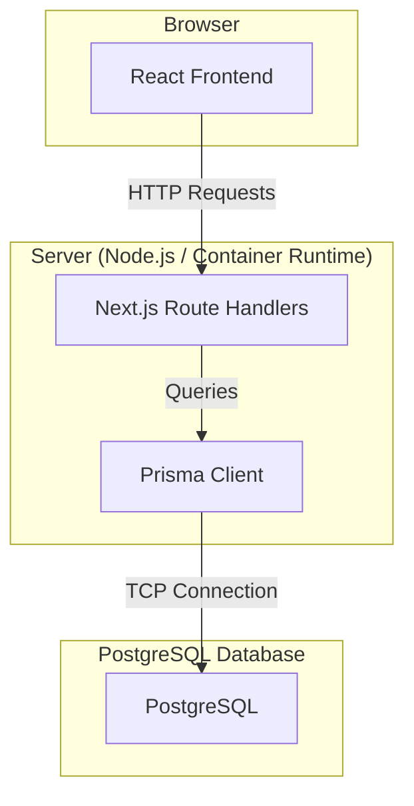

# Project Architecture

This document provides a high-level overview of the wedding website's architecture. The project is a full-stack application built with Next.js, leveraging its capabilities for both client-side rendering and server-side Route Handlers.

## Core Components

The application is composed of three main parts:

1.  **Frontend:** A React-based user interface built with Next.js App Router.
2.  **Backend:** Serverless Route Handlers built with Next.js App Router.
3.  **Database:** A PostgreSQL database managed with Prisma ORM.

## Deployment Architecture & Single-Site Default

The default supported architecture is **one deployment = one wedding site**:
- **Single Canonical Config**: Every deployment loads a single canonical configuration (`id: "global"`).
- **Simplified Setup**: No wildcard DNS, tenant concepts, or subdomain routing are required for standard setups.
- **Provider-Neutral Host Filtering**: Strict host and `X-Forwarded-Host` validation prevents host header injection and HTTP host spoofing without binding site data to incoming Host headers.
- **Optional Multi-Profile Subdomain Routing**: Subdomain-based `AppConfig` profile routing (`X-Forwarded-Host` checked before `Host` in `src/lib/config.ts`) can be enabled via `MULTISITE_ENABLED=true`. `MULTISITE_ENABLED` switches `AppConfig` branding/profile rows only; `prisma/schema.prisma` shares the other 15 tables across subdomains without tenant row isolation.

## Environment Specifications

For detailed runtime requirements, host configuration, environment variable specifications, and lifecycle expectations, see the authoritative [Application Runtime Contract](./docs/runtime-contract.md).

<!-- BEGIN AUTOGENERATED ENV -->
- **Node.js**: v22.x
- **Next.js**: ^16.4.6
- **React**: ^19.3.1
- **Prisma**: ^7.10.1
- **Zod**: ^4.6.7
<!-- END AUTOGENERATED ENV -->



### 1. Frontend

The frontend is built using [Next.js](https://nextjs.org/) and [React](https://react.dev/). It is responsible for rendering the user interface that guests and administrators interact with.

-   **Location:** `src/app/`
-   **Key Technologies:**
    -   **React:** For building UI components.
    -   **Next.js:** For App Router, server-side rendering, and client-side navigation.
    -   **Tailwind CSS:** For styling.
    -   **Framer Motion:** For animations.
    -   **React Query:** For managing server state, caching, and data fetching.
-   **Structure:**
    -   **App Router (`src/app/`):** Uses the Next.js App Router where directories define the routes and `page.tsx` renders the UI.
    -   **Components (`src/components/`):** Reusable UI elements are located here.
    -   **Admin UI:** A separate set of pages and components under `src/app/admin/` provides an interface for managing the website.

<!-- BEGIN AUTOGENERATED ROUTES -->
```mermaid
flowchart LR
    classDef page fill:#0284c7,stroke:#0369a1,color:#ffffff,stroke-width:2px;
    classDef api fill:#4c1d95,stroke:#3b82f6,color:#ffffff,stroke-width:2px;

    App["src/app"]
    node_admin["admin"]
    node_admin__dashboard["dashboard"]
    node_admin__dashboard__attractions["attractions"]
    node_admin__dashboard__content["content"]
    node_admin__dashboard__history["history"]
    node_admin__dashboard__invitation_d_codes["invitation-codes"]
    node_admin__dashboard__maintenance["maintenance"]
    node_admin__dashboard__media["media"]
    node_admin__dashboard__registry["registry"]
    node_admin__dashboard__seating_d_chart["seating-chart"]
    node_admin__dashboard__settings["settings"]
    node_admin__dashboard__site_d_manager["site-manager"]
    node_admin__dashboard__sub_d_events["sub-events"]
    node_admin__dashboard__thank_d_you_d_notes["thank-you-notes"]
    node_admin__dashboard__wedding_d_party["wedding-party"]
    node_admin__login["login"]
    node_admin__setup["setup"]
    node_api["api"]
    node_api__admin["admin"]
    node_api__admin___lb_entity_rb_["[entity]"]
    node_api__admin___lb_entity_rb____lb_id_rb_["[id]"]
    node_api__admin___lb_entity_rb___batch["batch"]
    node_api__admin__broadcast["broadcast"]
    node_api__admin__broadcast___lb_id_rb_["[id]"]
    node_api__admin__broadcast__history["history"]
    node_api__admin__broadcast__preview["preview"]
    node_api__admin__broadcast__retry["retry"]
    node_api__admin__broadcast__schedule["schedule"]
    node_api__admin__broadcast__schedule___lb_id_rb_["[id]"]
    node_api__admin__broadcast__send["send"]
    node_api__admin__broadcast__test_d_connection["test-connection"]
    node_api__admin__broadcast__test_d_send["test-send"]
    node_api__admin__contributors["contributors"]
    node_api__admin__contributors___lb_id_rb_["[id]"]
    node_api__admin__contributors___lb_id_rb___action["action"]
    node_api__admin__features["features"]
    node_api__admin__geocode["geocode"]
    node_api__admin__invitation_d_codes["invitation-codes"]
    node_api__admin__invitation_d_codes__batch["batch"]
    node_api__admin__invitation_d_codes__batch__validate["validate"]
    node_api__admin__invitation_d_codes__catalog["catalog"]
    node_api__admin__invitation_d_codes__export["export"]
    node_api__admin__invitation_d_codes__merge["merge"]
    node_api__admin__invitation_d_codes__rsvps["rsvps"]
    node_api__admin__invitation_d_codes__validate["validate"]
    node_api__admin__login["login"]
    node_api__admin__logout["logout"]
    node_api__admin__maintenance["maintenance"]
    node_api__admin__maintenance__export["export"]
    node_api__admin__maintenance__import["import"]
    node_api__admin__me["me"]
    node_api__admin__onboarding_d_milestones["onboarding-milestones"]
    node_api__admin__photos["photos"]
    node_api__admin__photos___lb_id_rb_["[id]"]
    node_api__admin__photos__moderation["moderation"]
    node_api__admin__photos__moderation__batch["batch"]
    node_api__admin__registry["registry"]
    node_api__admin__registry__items["items"]
    node_api__admin__registry__items___lb_id_rb_["[id]"]
    node_api__admin__registry__items___lb_id_rb___unclaim["unclaim"]
    node_api__admin__sample_d_data["sample-data"]
    node_api__admin__seating["seating"]
    node_api__admin__seating__assign["assign"]
    node_api__admin__seating__auto_d_assign["auto-assign"]
    node_api__admin__seating__export["export"]
    node_api__admin__settings["settings"]
    node_api__admin__setup["setup"]
    node_api__admin__sub_d_events["sub-events"]
    node_api__admin__sub_d_events__access["access"]
    node_api__admin__sub_d_events__access__batch["batch"]
    node_api__admin__sub_d_events__rsvp_d_summary["rsvp-summary"]
    node_api__admin__thank_d_you_d_notes["thank-you-notes"]
    node_api__admin__thank_d_you_d_notes___lb_id_rb_["[id]"]
    node_api__admin__thank_d_you_d_notes___lb_id_rb___send_d_email["send-email"]
    node_api__admin__thank_d_you_d_notes__batch["batch"]
    node_api__admin__thank_d_you_d_notes__export["export"]
    node_api__admin__thank_d_you_d_notes__export_d_labels["export-labels"]
    node_api__admin__upload["upload"]
    node_api__admin__versions["versions"]
    node_api__admin__versions___lb_id_rb_["[id]"]
    node_api__admin__versions___lb_id_rb___restore["restore"]
    node_api__cron["cron"]
    node_api__cron__broadcasts["broadcasts"]
    node_api__guest["guest"]
    node_api__guest__address["address"]
    node_api__guest__address__public["public"]
    node_api__guest__login["login"]
    node_api__guest__lookup["lookup"]
    node_api__guest__photos["photos"]
    node_api__guest__photos__upload["upload"]
    node_api__health["health"]
    node_api__live["live"]
    node_api__media["media"]
    node_api__media___lb_id_rb_["[id]"]
    node_api__media__export["export"]
    node_api__og["og"]
    node_api__photos["photos"]
    node_api__photos__upload["upload"]
    node_api__ready["ready"]
    node_api__registry["registry"]
    node_api__registry__capabilities["capabilities"]
    node_api__registry__claim["claim"]
    node_api__registry__contribute["contribute"]
    node_api__registry__items["items"]
    node_api__registry__items___lb_id_rb_["[id]"]
    node_api__registry__items__batch["batch"]
    node_api__registry__payment_d_intent["payment-intent"]
    node_api__registry__scrape["scrape"]
    node_api__registry__scrape__batch["batch"]
    node_api__registry__session["session"]
    node_api__registry__validate_d_code["validate-code"]
    node_api__registry__webhook["webhook"]
    node_api__registry__webhook__stripe["stripe"]
    node_api__rsvp["rsvp"]
    node_api__schedule["schedule"]
    node_api__schedule___lb_id_rb_["[id]"]
    node_api__schedule___lb_id_rb___ics["ics"]
    node_api__uploads["uploads"]
    node_api__uploads___lb__p__p__p_path_rb_["[...path]"]
    node_api__weather["weather"]
    node_archive["archive"]
    node_guest["guest"]
    node_guest__claim["claim"]
    node_guest__collect["collect"]
    node_guest__login["login"]
    node_heart["heart"]
    node_photos["photos"]
    node_photos__slideshow["slideshow"]
    node_project_d_info["project-info"]
    node_registry["registry"]
    node_registry__add_d_item["add-item"]
    node_registry__edit_d_item["edit-item"]
    node_registry__edit_d_item___lb_id_rb_["[id]"]
    node_things_d_to_d_do["things-to-do"]
    node_weather["weather"]
    node_wedding_d_party["wedding-party"]
    App --> node_admin
    node_admin --> node_admin__dashboard
    node_admin__dashboard --> node_admin__dashboard__attractions
    node_admin__dashboard --> node_admin__dashboard__content
    node_admin__dashboard --> node_admin__dashboard__history
    node_admin__dashboard --> node_admin__dashboard__invitation_d_codes
    node_admin__dashboard --> node_admin__dashboard__maintenance
    node_admin__dashboard --> node_admin__dashboard__media
    node_admin__dashboard --> node_admin__dashboard__registry
    node_admin__dashboard --> node_admin__dashboard__seating_d_chart
    node_admin__dashboard --> node_admin__dashboard__settings
    node_admin__dashboard --> node_admin__dashboard__site_d_manager
    node_admin__dashboard --> node_admin__dashboard__sub_d_events
    node_admin__dashboard --> node_admin__dashboard__thank_d_you_d_notes
    node_admin__dashboard --> node_admin__dashboard__wedding_d_party
    node_admin --> node_admin__login
    node_admin --> node_admin__setup
    App --> node_api
    node_api --> node_api__admin
    node_api__admin --> node_api__admin___lb_entity_rb_
    node_api__admin___lb_entity_rb_ --> node_api__admin___lb_entity_rb____lb_id_rb_
    node_api__admin___lb_entity_rb_ --> node_api__admin___lb_entity_rb___batch
    node_api__admin --> node_api__admin__broadcast
    node_api__admin__broadcast --> node_api__admin__broadcast___lb_id_rb_
    node_api__admin__broadcast --> node_api__admin__broadcast__history
    node_api__admin__broadcast --> node_api__admin__broadcast__preview
    node_api__admin__broadcast --> node_api__admin__broadcast__retry
    node_api__admin__broadcast --> node_api__admin__broadcast__schedule
    node_api__admin__broadcast__schedule --> node_api__admin__broadcast__schedule___lb_id_rb_
    node_api__admin__broadcast --> node_api__admin__broadcast__send
    node_api__admin__broadcast --> node_api__admin__broadcast__test_d_connection
    node_api__admin__broadcast --> node_api__admin__broadcast__test_d_send
    node_api__admin --> node_api__admin__contributors
    node_api__admin__contributors --> node_api__admin__contributors___lb_id_rb_
    node_api__admin__contributors___lb_id_rb_ --> node_api__admin__contributors___lb_id_rb___action
    node_api__admin --> node_api__admin__features
    node_api__admin --> node_api__admin__geocode
    node_api__admin --> node_api__admin__invitation_d_codes
    node_api__admin__invitation_d_codes --> node_api__admin__invitation_d_codes__batch
    node_api__admin__invitation_d_codes__batch --> node_api__admin__invitation_d_codes__batch__validate
    node_api__admin__invitation_d_codes --> node_api__admin__invitation_d_codes__catalog
    node_api__admin__invitation_d_codes --> node_api__admin__invitation_d_codes__export
    node_api__admin__invitation_d_codes --> node_api__admin__invitation_d_codes__merge
    node_api__admin__invitation_d_codes --> node_api__admin__invitation_d_codes__rsvps
    node_api__admin__invitation_d_codes --> node_api__admin__invitation_d_codes__validate
    node_api__admin --> node_api__admin__login
    node_api__admin --> node_api__admin__logout
    node_api__admin --> node_api__admin__maintenance
    node_api__admin__maintenance --> node_api__admin__maintenance__export
    node_api__admin__maintenance --> node_api__admin__maintenance__import
    node_api__admin --> node_api__admin__me
    node_api__admin --> node_api__admin__onboarding_d_milestones
    node_api__admin --> node_api__admin__photos
    node_api__admin__photos --> node_api__admin__photos___lb_id_rb_
    node_api__admin__photos --> node_api__admin__photos__moderation
    node_api__admin__photos__moderation --> node_api__admin__photos__moderation__batch
    node_api__admin --> node_api__admin__registry
    node_api__admin__registry --> node_api__admin__registry__items
    node_api__admin__registry__items --> node_api__admin__registry__items___lb_id_rb_
    node_api__admin__registry__items___lb_id_rb_ --> node_api__admin__registry__items___lb_id_rb___unclaim
    node_api__admin --> node_api__admin__sample_d_data
    node_api__admin --> node_api__admin__seating
    node_api__admin__seating --> node_api__admin__seating__assign
    node_api__admin__seating --> node_api__admin__seating__auto_d_assign
    node_api__admin__seating --> node_api__admin__seating__export
    node_api__admin --> node_api__admin__settings
    node_api__admin --> node_api__admin__setup
    node_api__admin --> node_api__admin__sub_d_events
    node_api__admin__sub_d_events --> node_api__admin__sub_d_events__access
    node_api__admin__sub_d_events__access --> node_api__admin__sub_d_events__access__batch
    node_api__admin__sub_d_events --> node_api__admin__sub_d_events__rsvp_d_summary
    node_api__admin --> node_api__admin__thank_d_you_d_notes
    node_api__admin__thank_d_you_d_notes --> node_api__admin__thank_d_you_d_notes___lb_id_rb_
    node_api__admin__thank_d_you_d_notes___lb_id_rb_ --> node_api__admin__thank_d_you_d_notes___lb_id_rb___send_d_email
    node_api__admin__thank_d_you_d_notes --> node_api__admin__thank_d_you_d_notes__batch
    node_api__admin__thank_d_you_d_notes --> node_api__admin__thank_d_you_d_notes__export
    node_api__admin__thank_d_you_d_notes --> node_api__admin__thank_d_you_d_notes__export_d_labels
    node_api__admin --> node_api__admin__upload
    node_api__admin --> node_api__admin__versions
    node_api__admin__versions --> node_api__admin__versions___lb_id_rb_
    node_api__admin__versions___lb_id_rb_ --> node_api__admin__versions___lb_id_rb___restore
    node_api --> node_api__cron
    node_api__cron --> node_api__cron__broadcasts
    node_api --> node_api__guest
    node_api__guest --> node_api__guest__address
    node_api__guest__address --> node_api__guest__address__public
    node_api__guest --> node_api__guest__login
    node_api__guest --> node_api__guest__lookup
    node_api__guest --> node_api__guest__photos
    node_api__guest__photos --> node_api__guest__photos__upload
    node_api --> node_api__health
    node_api --> node_api__live
    node_api --> node_api__media
    node_api__media --> node_api__media___lb_id_rb_
    node_api__media --> node_api__media__export
    node_api --> node_api__og
    node_api --> node_api__photos
    node_api__photos --> node_api__photos__upload
    node_api --> node_api__ready
    node_api --> node_api__registry
    node_api__registry --> node_api__registry__capabilities
    node_api__registry --> node_api__registry__claim
    node_api__registry --> node_api__registry__contribute
    node_api__registry --> node_api__registry__items
    node_api__registry__items --> node_api__registry__items___lb_id_rb_
    node_api__registry__items --> node_api__registry__items__batch
    node_api__registry --> node_api__registry__payment_d_intent
    node_api__registry --> node_api__registry__scrape
    node_api__registry__scrape --> node_api__registry__scrape__batch
    node_api__registry --> node_api__registry__session
    node_api__registry --> node_api__registry__validate_d_code
    node_api__registry --> node_api__registry__webhook
    node_api__registry__webhook --> node_api__registry__webhook__stripe
    node_api --> node_api__rsvp
    node_api --> node_api__schedule
    node_api__schedule --> node_api__schedule___lb_id_rb_
    node_api__schedule___lb_id_rb_ --> node_api__schedule___lb_id_rb___ics
    node_api --> node_api__uploads
    node_api__uploads --> node_api__uploads___lb__p__p__p_path_rb_
    node_api --> node_api__weather
    App --> node_archive
    App --> node_guest
    node_guest --> node_guest__claim
    node_guest --> node_guest__collect
    node_guest --> node_guest__login
    App --> node_heart
    App --> node_photos
    node_photos --> node_photos__slideshow
    App --> node_project_d_info
    App --> node_registry
    node_registry --> node_registry__add_d_item
    node_registry --> node_registry__edit_d_item
    node_registry__edit_d_item --> node_registry__edit_d_item___lb_id_rb_
    App --> node_things_d_to_d_do
    App --> node_weather
    App --> node_wedding_d_party
    class App page;
    class node_admin__dashboard page;
    class node_admin__dashboard__attractions page;
    class node_admin__dashboard__content page;
    class node_admin__dashboard__history page;
    class node_admin__dashboard__invitation_d_codes page;
    class node_admin__dashboard__maintenance page;
    class node_admin__dashboard__media page;
    class node_admin__dashboard__registry page;
    class node_admin__dashboard__seating_d_chart page;
    class node_admin__dashboard__settings page;
    class node_admin__dashboard__site_d_manager page;
    class node_admin__dashboard__sub_d_events page;
    class node_admin__dashboard__thank_d_you_d_notes page;
    class node_admin__dashboard__wedding_d_party page;
    class node_admin__login page;
    class node_admin__setup page;
    class node_api__admin___lb_entity_rb_ api;
    class node_api__admin___lb_entity_rb____lb_id_rb_ api;
    class node_api__admin___lb_entity_rb___batch api;
    class node_api__admin__broadcast___lb_id_rb_ api;
    class node_api__admin__broadcast__history api;
    class node_api__admin__broadcast__preview api;
    class node_api__admin__broadcast__retry api;
    class node_api__admin__broadcast__schedule___lb_id_rb_ api;
    class node_api__admin__broadcast__send api;
    class node_api__admin__broadcast__test_d_connection api;
    class node_api__admin__broadcast__test_d_send api;
    class node_api__admin__contributors___lb_id_rb_ api;
    class node_api__admin__contributors___lb_id_rb___action api;
    class node_api__admin__features api;
    class node_api__admin__geocode api;
    class node_api__admin__invitation_d_codes__batch api;
    class node_api__admin__invitation_d_codes__batch__validate api;
    class node_api__admin__invitation_d_codes__catalog api;
    class node_api__admin__invitation_d_codes__export api;
    class node_api__admin__invitation_d_codes__merge api;
    class node_api__admin__invitation_d_codes__rsvps api;
    class node_api__admin__invitation_d_codes__validate api;
    class node_api__admin__login api;
    class node_api__admin__logout api;
    class node_api__admin__maintenance__export api;
    class node_api__admin__maintenance__import api;
    class node_api__admin__me api;
    class node_api__admin__onboarding_d_milestones api;
    class node_api__admin__photos___lb_id_rb_ api;
    class node_api__admin__photos__moderation api;
    class node_api__admin__photos__moderation__batch api;
    class node_api__admin__registry__items___lb_id_rb___unclaim api;
    class node_api__admin__sample_d_data api;
    class node_api__admin__seating__assign api;
    class node_api__admin__seating__auto_d_assign api;
    class node_api__admin__seating__export api;
    class node_api__admin__settings api;
    class node_api__admin__setup api;
    class node_api__admin__sub_d_events__access api;
    class node_api__admin__sub_d_events__access__batch api;
    class node_api__admin__sub_d_events__rsvp_d_summary api;
    class node_api__admin__thank_d_you_d_notes api;
    class node_api__admin__thank_d_you_d_notes___lb_id_rb_ api;
    class node_api__admin__thank_d_you_d_notes___lb_id_rb___send_d_email api;
    class node_api__admin__thank_d_you_d_notes__batch api;
    class node_api__admin__thank_d_you_d_notes__export api;
    class node_api__admin__thank_d_you_d_notes__export_d_labels api;
    class node_api__admin__upload api;
    class node_api__admin__versions api;
    class node_api__admin__versions___lb_id_rb___restore api;
    class node_api__cron__broadcasts api;
    class node_api__guest__address api;
    class node_api__guest__address__public api;
    class node_api__guest__login api;
    class node_api__guest__lookup api;
    class node_api__guest__photos__upload api;
    class node_api__health api;
    class node_api__live api;
    class node_api__media api;
    class node_api__media___lb_id_rb_ api;
    class node_api__media__export api;
    class node_api__og api;
    class node_api__photos api;
    class node_api__photos__upload api;
    class node_api__ready api;
    class node_api__registry__capabilities api;
    class node_api__registry__claim api;
    class node_api__registry__contribute api;
    class node_api__registry__items api;
    class node_api__registry__items___lb_id_rb_ api;
    class node_api__registry__items__batch api;
    class node_api__registry__payment_d_intent api;
    class node_api__registry__scrape api;
    class node_api__registry__scrape__batch api;
    class node_api__registry__session api;
    class node_api__registry__validate_d_code api;
    class node_api__registry__webhook__stripe api;
    class node_api__rsvp api;
    class node_api__schedule api;
    class node_api__schedule___lb_id_rb___ics api;
    class node_api__uploads___lb__p__p__p_path_rb_ api;
    class node_api__weather api;
    class node_archive page;
    class node_guest page;
    class node_guest__claim page;
    class node_guest__collect page;
    class node_guest__login page;
    class node_heart page;
    class node_photos page;
    class node_photos__slideshow page;
    class node_project_d_info page;
    class node_registry page;
    class node_registry__add_d_item page;
    class node_registry__edit_d_item___lb_id_rb_ page;
    class node_things_d_to_d_do page;
    class node_weather page;
    class node_wedding_d_party page;
```

<!-- END AUTOGENERATED ROUTES -->

### 2. Backend (API)

The backend is a set of serverless functions implemented as Next.js Route Handlers. These routes handle business logic, data validation, and communication with the database.

- **Location:** `src/app/api/`
- **Key Technologies:**
  - **Next.js Route Handlers:** For creating serverless API endpoints.
  - **Prisma:** As the ORM for database access.
- **Route Groups & Access Tiers:** Most API route handlers under `src/app/api/**/route.{ts,tsx}` wrap execution with `withApiMiddleware` ([src/utils/withApiMiddleware.ts](src/utils/withApiMiddleware.ts)), while specialized binary, probe, and webhook endpoints stream responses directly (exact handler and wrapper totals are synchronized automatically in the inventory below). Edge perimeter and role rules are enforced by [src/middleware.ts](src/middleware.ts) and [src/lib/routes.ts](src/lib/routes.ts): `GET /api/og` ([src/app/metadata.ts](src/app/metadata.ts)), `GET /api/admin/me`, and `POST /api/admin/logout` bypass the Edge cookie gate as `Public` endpoints (retaining `withApiMiddleware` rate limits on `/api/admin/me` and `/api/admin/logout`); `/api/media` (`GET`, `POST`), `/api/media/[id]` (`PUT` and `DELETE` metadata mutations only, with no `GET` asset resolver), and `/api/media/export` (`GET`, `POST`) are strictly `Admin-only` routes gated by `isAdminRequest`; `/api/guest/address` and `/api/rsvp` require a personalized `guest_invite_session` cookie (`Invite-only`, verified via `getGuestInviteSession`); `/api/cron/*` routes require `Authorization: Bearer <CRON_SECRET>`; and `/api/registry/webhook/stripe` bypasses the Edge cookie gate on `POST` only while enforcing cryptographic `stripe-signature` verification (`STRIPE_WEBHOOK_SECRET`).

<!-- BEGIN AUTOGENERATED API_ROUTES -->
Total API route handlers: **82** across **14** route groups.

- **Middleware Wrapper (`withApiMiddleware`):** **77** wrapped handlers; **5** unwrapped (`/api/live`, `/api/og`, `/api/ready`, `/api/registry/webhook/stripe`, `/api/uploads/[...path]`).
- **Handler Session & Webhook Gates:** `Invite-only` handlers (`/api/guest/address`, `/api/rsvp`) require a verified `guest_invite_session` cookie via `getGuestInviteSession`; `/api/registry/webhook/stripe` bypasses the Edge cookie gate on `POST` in `src/middleware.ts` (retaining Edge cookie enforcement on other methods) and verifies `stripe-signature` (`STRIPE_WEBHOOK_SECRET`) in the handler.

#### Admin Routes (`/api/admin` — 50 handlers)

| Route | Handler | Methods | Access Tier |
|---|---|---|---|
| `/api/admin/[entity]` | `src/app/api/admin/[entity]/route.ts` | `GET`, `POST`, `PUT` | `Admin-only` |
| `/api/admin/[entity]/[id]` | `src/app/api/admin/[entity]/[id]/route.ts` | `GET`, `PUT`, `DELETE` | `Admin-only` |
| `/api/admin/[entity]/batch` | `src/app/api/admin/[entity]/batch/route.ts` | `POST`, `PUT`, `PATCH`, `DELETE` | `Admin-only` |
| `/api/admin/broadcast/[id]` | `src/app/api/admin/broadcast/[id]/route.ts` | `GET` | `Admin-only` |
| `/api/admin/broadcast/history` | `src/app/api/admin/broadcast/history/route.ts` | `GET` | `Admin-only` |
| `/api/admin/broadcast/preview` | `src/app/api/admin/broadcast/preview/route.ts` | `POST` | `Admin-only` |
| `/api/admin/broadcast/retry` | `src/app/api/admin/broadcast/retry/route.ts` | `POST` | `Admin-only` |
| `/api/admin/broadcast/schedule/[id]` | `src/app/api/admin/broadcast/schedule/[id]/route.ts` | `DELETE` | `Admin-only` |
| `/api/admin/broadcast/send` | `src/app/api/admin/broadcast/send/route.ts` | `POST` | `Admin-only` |
| `/api/admin/broadcast/test-connection` | `src/app/api/admin/broadcast/test-connection/route.ts` | `POST` | `Admin-only` |
| `/api/admin/broadcast/test-send` | `src/app/api/admin/broadcast/test-send/route.ts` | `POST` | `Admin-only` |
| `/api/admin/contributors/[id]` | `src/app/api/admin/contributors/[id]/route.ts` | `PATCH`, `DELETE` | `Admin-only` |
| `/api/admin/contributors/[id]/action` | `src/app/api/admin/contributors/[id]/action/route.ts` | `POST` | `Admin-only` |
| `/api/admin/features` | `src/app/api/admin/features/route.ts` | `GET`, `PUT` | `Admin-only` |
| `/api/admin/geocode` | `src/app/api/admin/geocode/route.ts` | `GET` | `Admin-only` |
| `/api/admin/invitation-codes/batch` | `src/app/api/admin/invitation-codes/batch/route.ts` | `POST`, `PUT`, `PATCH`, `DELETE` | `Admin-only` |
| `/api/admin/invitation-codes/batch/validate` | `src/app/api/admin/invitation-codes/batch/validate/route.ts` | `POST` | `Admin-only` |
| `/api/admin/invitation-codes/catalog` | `src/app/api/admin/invitation-codes/catalog/route.ts` | `GET` | `Admin-only` |
| `/api/admin/invitation-codes/export` | `src/app/api/admin/invitation-codes/export/route.ts` | `GET` | `Admin-only` |
| `/api/admin/invitation-codes/merge` | `src/app/api/admin/invitation-codes/merge/route.ts` | `POST` | `Admin-only` |
| `/api/admin/invitation-codes/rsvps` | `src/app/api/admin/invitation-codes/rsvps/route.ts` | `GET`, `PUT` | `Admin-only` |
| `/api/admin/invitation-codes/validate` | `src/app/api/admin/invitation-codes/validate/route.ts` | `POST` | `Admin-only` |
| `/api/admin/login` | `src/app/api/admin/login/route.ts` | `POST` | `Public` |
| `/api/admin/logout` | `src/app/api/admin/logout/route.ts` | `POST` | `Public` |
| `/api/admin/maintenance/export` | `src/app/api/admin/maintenance/export/route.ts` | `GET` | `Admin-only` |
| `/api/admin/maintenance/import` | `src/app/api/admin/maintenance/import/route.ts` | `POST` | `Admin-only` |
| `/api/admin/me` | `src/app/api/admin/me/route.ts` | `GET` | `Public` |
| `/api/admin/onboarding-milestones` | `src/app/api/admin/onboarding-milestones/route.ts` | `GET` | `Admin-only` |
| `/api/admin/photos/[id]` | `src/app/api/admin/photos/[id]/route.ts` | `PATCH` | `Admin-only` |
| `/api/admin/photos/moderation` | `src/app/api/admin/photos/moderation/route.ts` | `GET`, `PATCH` | `Admin-only` |
| `/api/admin/photos/moderation/batch` | `src/app/api/admin/photos/moderation/batch/route.ts` | `POST` | `Admin-only` |
| `/api/admin/registry/items/[id]/unclaim` | `src/app/api/admin/registry/items/[id]/unclaim/route.ts` | `POST` | `Admin-only` |
| `/api/admin/sample-data` | `src/app/api/admin/sample-data/route.ts` | `GET`, `POST`, `DELETE` | `Admin-only` |
| `/api/admin/seating/assign` | `src/app/api/admin/seating/assign/route.ts` | `POST` | `Admin-only` |
| `/api/admin/seating/auto-assign` | `src/app/api/admin/seating/auto-assign/route.ts` | `POST` | `Admin-only` |
| `/api/admin/seating/export` | `src/app/api/admin/seating/export/route.ts` | `GET` | `Admin-only` |
| `/api/admin/settings` | `src/app/api/admin/settings/route.ts` | `GET`, `POST`, `PUT` | `Admin-only` |
| `/api/admin/setup` | `src/app/api/admin/setup/route.ts` | `GET`, `POST` | `Public` |
| `/api/admin/sub-events/access` | `src/app/api/admin/sub-events/access/route.ts` | `GET`, `PUT` | `Admin-only` |
| `/api/admin/sub-events/access/batch` | `src/app/api/admin/sub-events/access/batch/route.ts` | `POST` | `Admin-only` |
| `/api/admin/sub-events/rsvp-summary` | `src/app/api/admin/sub-events/rsvp-summary/route.ts` | `GET` | `Admin-only` |
| `/api/admin/thank-you-notes` | `src/app/api/admin/thank-you-notes/route.ts` | `GET`, `POST` | `Admin-only` |
| `/api/admin/thank-you-notes/[id]` | `src/app/api/admin/thank-you-notes/[id]/route.ts` | `PATCH` | `Admin-only` |
| `/api/admin/thank-you-notes/[id]/send-email` | `src/app/api/admin/thank-you-notes/[id]/send-email/route.ts` | `POST` | `Admin-only` |
| `/api/admin/thank-you-notes/batch` | `src/app/api/admin/thank-you-notes/batch/route.ts` | `POST` | `Admin-only` |
| `/api/admin/thank-you-notes/export` | `src/app/api/admin/thank-you-notes/export/route.ts` | `GET` | `Admin-only` |
| `/api/admin/thank-you-notes/export-labels` | `src/app/api/admin/thank-you-notes/export-labels/route.ts` | `GET` | `Admin-only` |
| `/api/admin/upload` | `src/app/api/admin/upload/route.ts` | `POST` | `Admin-only` |
| `/api/admin/versions` | `src/app/api/admin/versions/route.ts` | `GET` | `Admin-only` |
| `/api/admin/versions/[id]/restore` | `src/app/api/admin/versions/[id]/restore/route.ts` | `POST` | `Admin-only` |

#### Cron Routes (`/api/cron` — 1 handler)

| Route | Handler | Methods | Access Tier |
|---|---|---|---|
| `/api/cron/broadcasts` | `src/app/api/cron/broadcasts/route.ts` | `GET`, `POST` | `Bearer (CRON_SECRET)` |

#### Guest Routes (`/api/guest` — 5 handlers)

| Route | Handler | Methods | Access Tier |
|---|---|---|---|
| `/api/guest/address` | `src/app/api/guest/address/route.ts` | `GET`, `PUT` | `Invite-only` |
| `/api/guest/address/public` | `src/app/api/guest/address/public/route.ts` | `POST` | `Public` |
| `/api/guest/login` | `src/app/api/guest/login/route.ts` | `POST` | `Public` |
| `/api/guest/lookup` | `src/app/api/guest/lookup/route.ts` | `POST` | `Guest / Admin` |
| `/api/guest/photos/upload` | `src/app/api/guest/photos/upload/route.ts` | `POST` | `Guest / Admin` |

#### Health Check Routes (`/api/health` — 1 handler)

| Route | Handler | Methods | Access Tier |
|---|---|---|---|
| `/api/health` | `src/app/api/health/route.ts` | `GET` | `Public` |

#### Liveness Probe Routes (`/api/live` — 1 handler)

| Route | Handler | Methods | Access Tier |
|---|---|---|---|
| `/api/live` | `src/app/api/live/route.ts` | `GET` | `Public` |

#### Media Routes (`/api/media` — 3 handlers)

| Route | Handler | Methods | Access Tier |
|---|---|---|---|
| `/api/media` | `src/app/api/media/route.ts` | `GET`, `POST` | `Admin-only` |
| `/api/media/[id]` | `src/app/api/media/[id]/route.ts` | `PUT`, `DELETE` | `Admin-only` |
| `/api/media/export` | `src/app/api/media/export/route.ts` | `GET`, `POST` | `Admin-only` |

#### Open Graph Routes (`/api/og` — 1 handler)

| Route | Handler | Methods | Access Tier |
|---|---|---|---|
| `/api/og` | `src/app/api/og/route.tsx` | `GET` | `Public` |

#### Photos Routes (`/api/photos` — 2 handlers)

| Route | Handler | Methods | Access Tier |
|---|---|---|---|
| `/api/photos` | `src/app/api/photos/route.ts` | `GET` | `Guest / Admin` |
| `/api/photos/upload` | `src/app/api/photos/upload/route.ts` | `POST` | `Guest / Admin` |

#### Readiness Probe Routes (`/api/ready` — 1 handler)

| Route | Handler | Methods | Access Tier |
|---|---|---|---|
| `/api/ready` | `src/app/api/ready/route.ts` | `GET` | `Public` |

#### Registry Routes (`/api/registry` — 12 handlers)

| Route | Handler | Methods | Access Tier |
|---|---|---|---|
| `/api/registry/capabilities` | `src/app/api/registry/capabilities/route.ts` | `GET` | `Guest / Admin` |
| `/api/registry/claim` | `src/app/api/registry/claim/route.ts` | `GET`, `POST` | `Public` |
| `/api/registry/contribute` | `src/app/api/registry/contribute/route.ts` | `POST` | `Guest / Admin` |
| `/api/registry/items` | `src/app/api/registry/items/route.ts` | `GET`, `POST` | `Guest / Admin` (`GET`); `Admin-only` (`POST`) |
| `/api/registry/items/[id]` | `src/app/api/registry/items/[id]/route.ts` | `GET`, `PUT`, `DELETE` | `Guest / Admin` (`GET`); `Admin-only` (`PUT`, `DELETE`) |
| `/api/registry/items/batch` | `src/app/api/registry/items/batch/route.ts` | `POST` | `Admin-only` |
| `/api/registry/payment-intent` | `src/app/api/registry/payment-intent/route.ts` | `POST` | `Guest / Admin` |
| `/api/registry/scrape` | `src/app/api/registry/scrape/route.ts` | `POST` | `Admin-only` |
| `/api/registry/scrape/batch` | `src/app/api/registry/scrape/batch/route.ts` | `POST` | `Admin-only` |
| `/api/registry/session` | `src/app/api/registry/session/route.ts` | `GET`, `DELETE` | `Guest / Admin` |
| `/api/registry/validate-code` | `src/app/api/registry/validate-code/route.ts` | `GET` | `Public` |
| `/api/registry/webhook/stripe` | `src/app/api/registry/webhook/stripe/route.ts` | `POST` | `stripeSignature (STRIPE_WEBHOOK_SECRET)` |

#### RSVP Routes (`/api/rsvp` — 1 handler)

| Route | Handler | Methods | Access Tier |
|---|---|---|---|
| `/api/rsvp` | `src/app/api/rsvp/route.ts` | `POST` | `Invite-only` |

#### Schedule Routes (`/api/schedule` — 2 handlers)

| Route | Handler | Methods | Access Tier |
|---|---|---|---|
| `/api/schedule` | `src/app/api/schedule/route.ts` | `GET` | `Guest / Admin` |
| `/api/schedule/[id]/ics` | `src/app/api/schedule/[id]/ics/route.ts` | `GET` | `Guest / Admin` |

#### Uploads Routes (`/api/uploads` — 1 handler)

| Route | Handler | Methods | Access Tier |
|---|---|---|---|
| `/api/uploads/[...path]` | `src/app/api/uploads/[...path]/route.ts` | `GET`, `HEAD` | `Public` |

#### Weather Routes (`/api/weather` — 1 handler)

| Route | Handler | Methods | Access Tier |
|---|---|---|---|
| `/api/weather` | `src/app/api/weather/route.ts` | `GET` | `Guest / Admin` |

<!-- END AUTOGENERATED API_ROUTES -->

### 3. Database

The database stores all application data using PostgreSQL managed via Prisma ORM.

- **Location:** The schema is defined in [prisma/schema.prisma](https://github.com/fderuiter/wedding_website/blob/HEAD/prisma/schema.prisma).
- **Key Technologies:**
  - **PostgreSQL:** Relational database implementing the project's standard database contract (compatible with local PostgreSQL, Neon, Supabase, Railway, AWS RDS, GCP Cloud SQL, etc. as labeled host examples).
  - **Prisma:** The ORM used to define the schema and interact with the database in a type-safe way.
- **Data Models:**
  - **`AppConfig`:** Stores global site settings, partner details, wedding date and venue parameters, visual theme tokens, feature toggles, and email/SMS broadcast provider credentials.
  - **`Media`:** Stores uploaded media metadata (URLs, alt text, decorative/sample flags) referenced by wedding party members, attractions, and registry items.
  - **`WeddingPartyMember`:** Represents members of the wedding party with name, role, bio, side (`BRIDE`, `GROOM`, `JOINT`), display order, and optional media relationship.
  - **`Attraction`:** Represents local attraction and accommodation recommendations, including categories, map coordinates, booking URLs, promo codes, and shuttle information.
  - **`RegistryItem`:** Represents gift registry items with item type, price, display order, quantity, group gift / most wanted flags, purchase status, and total contributed amount.
  - **`Contributor`:** Stores guest financial contributions towards registry items, including contributor contact info, contribution amounts, custom messages, and thank-you note status.
  - **`InvitationCode`:** Stores unique guest invitation passes, guest names, mailing addresses, dietary notes, plus-one allocations, party tags, assigned table and inline seat references (`tableId`, `seatNumber`, `plusOneSeatNumbers`), and projected aggregate RSVP state (`used`, `usedAt`, `plusOneFirstName`, `plusOneLastName`, `dietaryNotes`, and JSON `extraFields`).
  - **`SeatingTable`:** Stores reception seating tables with table name, shape, seat capacity, and floor plan coordinate attributes (`x`, `y`, `width`, `height`, `rotation`).
  - **`ContentNode`:** Provides dynamic CMS content storage for site copy, FAQ entries, announcements, and key-value JSON attributes tagged by domain (including legacy or lightweight `Schedule` and `Logistics` entries that coexist as read-only schedule fallbacks when no `SubEvent` rows match).
  - **`SnapshotVersion`:** Stores audit logs and JSON entity snapshot history for change tracking and point-in-time state restoration.
  - **`SubEvent`:** Represents individual wedding schedule items (e.g., rehearsal dinner, ceremony, reception) in [prisma/schema.prisma](prisma/schema.prisma#L300-L317) with start/end times, venue details, privacy settings (`isPrivate`), and structured JSONB configuration columns (`mealOptions` and `customQuestions`).
  - **`SubEventAccess`:** Junction table defining explicit access permissions for private sub-events mapped to guest invitation codes.
  - **`SubEventRsvp`:** Canonical per-event RSVP table in [prisma/schema.prisma](prisma/schema.prisma#L330-L346) storing attendance `status`, `plusOneCount`, `dietaryNotes`, and structured JSONB response columns (`mealSelections`, `customAnswers`, and `plusOneNames`).
  - **`BroadcastMessage`:** Stores outbound email and SMS communication broadcasts, tracking target filters, delivery status, send timestamps, and dispatch counts.
  - **`BroadcastRecipient`:** Stores individual delivery logs for broadcast messages, recording destination addresses, delivery status, and error details.
- **Canonical `SubEventRsvp` Projection & `ContentNode` Coexistence:**
  - **Canonical `SubEventRsvp` -> `InvitationCode` Synchronization:** Guest submissions (`POST /api/rsvp`) and administrative RSVP overrides in `SubEventService` ([src/features/sub-events/service.ts](src/features/sub-events/service.ts#L604-L1162)) transactionally project aggregate RSVP state from `SubEventRsvp` onto `InvitationCode` (`used`, `usedAt`, `plusOneFirstName`, `plusOneLastName`, `dietaryNotes`, and `extraFields` keys `attendanceStatus`, `plusOneCount`, `plusOneNames`, `dietaryTags`, `mealSelections`, `mealSummary`, `customAnswers`, `customAnswersSummary`, and `eventRsvps`). Downstream seating and roster helpers—specifically `getGuestAttendanceStatus`, `isGuestEligibleForSeating`, and `getDietaryBadges` in [src/features/seating/utils/seatingHelpers.ts](src/features/seating/utils/seatingHelpers.ts#L134-L216)—consume those projected `InvitationCode` fields. `SubEventRsvp` remains authoritative for attendance, meal, and custom-question responses (batch `InvitationCode` edits strip reserved RSVP projection keys rather than back-populating `SubEventRsvp` attendance), while `InvitationCodeAdminService.update` ([src/features/registry/invitation-code.admin.service.ts](src/features/registry/invitation-code.admin.service.ts#L177-L502)) synchronizes updated guest/plus-one names onto attending `SubEventRsvp` records and recomputes projected `InvitationCode.extraFields` summaries.
  - **Read-Only `ContentNode` Schedule Fallbacks:** When a requested schedule item has no `SubEvent` record, `SubEventService` ([src/features/sub-events/service.ts](src/features/sub-events/service.ts#L375-L408)) falls back to `Schedule` or `Logistics` `ContentNode` records with `isReadOnly: true` (enforcing `isPrivateContentNode` access checks and rejecting RSVP submissions against read-only fallback nodes with HTTP `400`). On the homepage, `HomePageClient` ([src/components/home/HomePageClient.tsx](src/components/home/HomePageClient.tsx#L257-L300)) renders `InteractiveTimeline` whenever structured `Schedule` or `startTime` entries exist in `contentNodes` and falls back to `Logistics` ceremony/reception summary cards (`ceremonyTitle`, `receptionTitle`) otherwise.

The use of Prisma allows for easy schema management through migrations and provides a type-safe client for querying the database from the backend API. The project uses PostgreSQL as the sole active database layer for both local development and production.

### 4. Core Framework Infrastructure

To establish consistent data access, transaction management, state auditing, and session security across all application features, the codebase utilizes a centralized core framework layer located in `src/core/`.

#### Infrastructure Data Access Layer (`src/core/infrastructure/`)

- **`BaseRepository` ([src/core/infrastructure/repository.ts](https://github.com/fderuiter/wedding_website/blob/HEAD/src/core/infrastructure/repository.ts)):** The foundation for database interactions. It encapsulates standard Prisma CRUD queries (`findMany`, `findUnique`, `create`, `update`, `delete`), supports transactional execution via `transaction()`, and allows client context swapping with `withClient()`. Deletion operations automatically call `createAuditSnapshot` to record deletion audit logs.
- **`BaseService` ([src/core/infrastructure/service.ts](https://github.com/fderuiter/wedding_website/blob/HEAD/src/core/infrastructure/service.ts)):** The foundation for business logic services. It wraps `BaseRepository` instances, provides default query argument merging for sorting and relations, and enforces transactional mutation lifecycles. It includes extensibility hooks (`validate`, `preSave`) and manages point-in-time audit snapshot creation (`createSnapshot`) whenever records are created or updated. It also provides a built-in utility for record reordering (`reorder`).

#### Authentication Modules (`src/core/auth/`)

- **Shared Token & Cookie Primitives ([src/core/auth/tokenCookieHelpers.ts](src/core/auth/tokenCookieHelpers.ts)):** Centralizes compact token signing (`signCompactToken` producing `base64url(payload).base64url(signature)` via HMAC-SHA256), constant-time signature verification (`verifyCompactToken` using `timingSafeEqualJS`), and request cookie extraction (`readRequestCookie` reading from `NextRequest.cookies`, raw `cookie` headers, or Next.js Server Component `cookies()`).
- **Server Admin Authentication ([src/core/auth/auth.server.ts](src/core/auth/auth.server.ts)):** Handles server-side administrative session management using `tokenCookieHelpers.ts` and `ADMIN_PASSWORD` as the HMAC signing secret. It provides `signAdminToken`, `verifyAdminToken`, and `isAdminRequest` against the `admin_auth` `HttpOnly` cookie, plus `setAdminAuthCookie` / `getAdminCookieOptions` (`httpOnly`, `sameSite: 'lax'`, `secure` in production, 8-hour default `maxAge`).
- **Client Admin Authentication ([src/core/auth/auth.client.ts](src/core/auth/auth.client.ts)):** Provides client-side session verification via `checkAdminClient()`, which queries the `Public` `GET /api/admin/me` endpoint (returning `{ success: true, isAdmin: false }` when unauthenticated) without requiring a guest cookie or exposing internal token secrets, while `POST /api/admin/logout` clears stale `admin_auth` cookies cleanly.
- **Server Guest Authentication ([src/core/auth/guest.server.ts](src/core/auth/guest.server.ts)):** Manages shared-passcode guest sessions via `tokenCookieHelpers.ts`. It signs and verifies `guest_auth` tokens (`signGuestToken`, `isGuestRequest`) exclusively with `GUEST_SESSION_SECRET` (requiring a distinct secret of at least 32 characters in production and throwing an error whenever `secret === passcode`, i.e., `GUEST_SESSION_SECRET === GUEST_PASSCODE`).
- **Stateless Edge Guest Invite Token ([src/core/auth/guestInviteToken.ts](src/core/auth/guestInviteToken.ts#L46-L122)):** Implements Tier 1 Edge-safe token signing and stateless verification (`signGuestInviteSessionToken`, `verifyGuestInviteSessionToken`, `getSignedGuestInviteSession`) for the 7-day `guest_invite_session` cookie using `GUEST_SESSION_SECRET` (>= 32 characters in production, rejecting `secret === passcode`) with zero Prisma or Node-only dependencies so [src/middleware.ts](src/middleware.ts) runs cleanly in the Edge runtime.
- **Database-Backed Guest Invitation Session & Revocation ([src/core/auth/guestInviteSession.ts](src/core/auth/guestInviteSession.ts#L52-L239)):** Implements Tier 2 Node/Server session validation and immediate revocation (`getGuestInviteSession`, `enforceActiveGuestPageSession`, backed by per-request hydration in [src/lib/requestContext.ts](src/lib/requestContext.ts)). After verifying the signed cookie via `getSignedGuestInviteSession`, it queries `prisma.invitationCode` to confirm the invitation code still exists and has `isSample: false`—immediately invalidating deleted, rotated, or purged sample sessions. On guest-gated SSR pages, `RootLayout` ([src/app/layout.tsx](src/app/layout.tsx#L116-L118)) calls `enforceActiveGuestPageSession()`, issuing a `303 See Other` redirect to `/guest/login` when a `guest_invite_session` is revoked and neither `admin_auth` nor `guest_auth` is valid. On non-excluded API routes (`isInviteRevocationExcludedApiPath` in [src/utils/withApiMiddleware.ts](src/utils/withApiMiddleware.ts#L39-L175)), `withApiMiddleware` calls `getGuestInviteSession(req)` and responds with HTTP `401` while clearing `guest_invite_session` (`maxAge: 0`) when no fallback `admin_auth` or `guest_auth` cookie exists.
- **Guest Login vs. Read-Only Lookup Endpoints ([src/app/api/guest/login/route.ts](src/app/api/guest/login/route.ts), [src/app/api/guest/lookup/route.ts](src/app/api/guest/lookup/route.ts)):** `POST /api/guest/login` authenticates credentials and mints 7-day `HttpOnly` cookies—issuing `guest_auth` when matching the shared `GUEST_PASSCODE` (via constant-time SHA-256 comparison) or `guest_invite_session` when matching a non-sample (`isSample: false`) `InvitationCode`. By contrast, `POST /api/guest/lookup` (throttled to 5 failed attempts per 15 minutes in `withApiMiddleware`) performs a read-only search across non-sample `InvitationCode` records by name, plus-one name, or email and returns only `{ guestName }` without minting cookies or exposing invitation codes.

### 5. Feature Organization

To maintain modularity and prevent logic smear, the codebase adopts a strict layered feature architecture. All domain-specific logic is encapsulated in isolated feature directories under `src/features/`.

-   **Location:** `src/features/`
-   **Structure:** Each feature scaffolded by [scripts/scaffold-feature.mjs](scripts/scaffold-feature.mjs#L30) contains:
    -   `api/`: Route handlers and server-side logic (e.g., proxying).
    -   `components/`: UI components specific to the feature.
    -   `hooks/`: Custom React hooks.
    -   `lib/`: Internal feature-scoped helper utilities.
    -   `repository.ts`: Data access layer for Prisma queries.
    -   `service.ts`: Business logic layer.
    -   `schemas.ts`: Validation schemas (Zod).
    -   `types.ts`: TypeScript interfaces.
    -   `index.ts`: The public interface. To prevent cross-domain internal leakage, other modules must solely import from this file (enforced by `no-restricted-imports` in [eslint.config.mjs](eslint.config.mjs#L255-L272) against both `@/features/*/*` and relative `../features/*/*` paths).

New features should be scaffolded using the included CLI utility (`npm run scaffold <feature-name>`) to ensure correct structural boundaries and naming conventions.

### 6. Architectural Boundaries & Shared Components Guidelines

To prevent code duplication and maintain clear ownership boundaries while preserving file-path stability for downstream template forks, the codebase balances feature encapsulation with documented shared-folder exceptions.

#### Folder Boundaries
* **Generic & Cross-Cutting Shared Directories (`src/components/`, `src/components/ui/`, `src/utils/`, `src/lib/`):**
  * New reusable UI primitives (e.g., `Button`, `Dialog` in `src/components/ui/`) and stateless helpers (e.g., `cn` in `src/utils/cn.ts`) belong in these shared directories and should stay domain-agnostic.
  * **Documented Shared-Folder Exceptions (Preserved for Downstream Fork Stability):** Core runtime singletons and cross-cutting services intentionally reside at stable paths under `src/lib/`, `src/utils/`, and `src/components/` so downstream adopters merge upgrades cleanly without path churn:
    * `src/lib/`: Database connection singletons (`prisma.ts`, `postgresPool.ts`), global `AppConfig` resolution (`config.ts`), snapshot audit logging (`audit.ts`), theme/preset engines (`theme/presets.ts`, `theme/stylesheet.ts`), module registry (`modules.ts`), and sample data seeding (`sampleData/generator.ts`).
    * `src/utils/`: Cross-route API middleware (`withApiMiddleware.ts`), backup/invitation/RSVP validation helpers (`backupValidation.ts`, `invitationValidation.ts`, `rsvpDeadline.ts`), and calendar/pagination utilities.
    * `src/components/`: Root layout providers (`ThemeProvider.tsx`, `RootLayoutClient.tsx`), multi-feature page orchestrators (`home/HomePageClient.tsx`), and onboarding/admin shells (`setup/SetupWizard.tsx`).
* **Feature Directories (`src/features/<feature-name>/`):**
  * Feature directories contain UI components, hooks, internal `lib/` helpers, schema definitions, repositories, and services scoped to a single domain (e.g., `weather`, `registry`, `seating`, `sub-events`, `broadcast`).
  * Feature internals must not be imported directly across module boundaries; external callers import exclusively through the feature's public barrel (`@/features/<feature-name>`, backed by `src/features/<feature-name>/index.ts`) as enforced by `eslint.config.mjs`.

#### Structural Rules for Shared UI Primitives
Shared UI primitives added to `src/components/ui/` must adhere to the following design and quality patterns:

1. **React Ref Forwarding (DOM-Wrapping Primitives):**
   * Interactive and layout primitives that wrap a single underlying DOM element (such as `Button`, `Input`, `Select`, `Textarea`, `Checkbox`, `Dialog`, `Table`, `Icon`, `Skeleton`, and `Layout` primitives) must forward `ref` to their root DOM node using React 19 `ref` props (`React.ComponentPropsWithRef<'...'>`, or `React.forwardRef`).
   * Stateful, context, portal/provider, or error-boundary components in `src/components/ui/` that do not represent a single ref-target DOM element (`ErrorBoundary`, `GlobalRadialGlow`, `RouteErrorFallback`, `ThemeSelector`, and `ToastProvider`) are exempt from DOM `ref` forwarding.
   * *Example:*
     ```tsx
     import React from 'react';
     import { cn } from '@/utils/cn';

     export interface InputProps extends React.ComponentPropsWithRef<'input'> {}

     export function Input({ className, type, ref, ...props }: InputProps) {
       return (
         <input
           type={type}
           className={cn('border rounded px-3 py-2', className)}
           ref={ref}
           {...props}
         />
       );
     }
     ```

2. **Style Composition / Class Merging:**
   * Primitives must be highly configurable from the outside. Default Tailwind styles must be composed with custom styles passed via the `className` prop.
   * Class composition uses the lightweight `cn(...)` helper in [src/utils/cn.ts](src/utils/cn.ts) (`classes.filter(Boolean).join(' ')`), which filters falsy values and joins truthy class strings with spaces **without** performing Tailwind utility conflict resolution (`tailwind-merge` is not installed). Avoid passing conflicting Tailwind utilities in base and override class strings.
   * *Example:*
     ```tsx
     import { cn } from '@/utils/cn';
     // Usage inside a component:
     className={cn('base-classes-here', className)}
     ```

3. **Unit Tests:**
   * Every new shared UI primitive must have a matching unit test file inside the respective `__tests__` directory (e.g., `src/components/ui/__tests__/<Component>.test.tsx`).
   * Unit tests must verify proper rendering, prop-based configuration, custom ref forwarding, and interactive behavior (e.g., fire events).

## Upstream Compatibility & Downstream Upgrade Architecture

To treat upstream compatibility as a product feature for downstream template adopters, the architecture enforces strict separation between application code, personal content, and deployment configuration:

- **Personal Content Isolation**: Couple details, venue information, story text, wedding party members, registry items, and photos reside in PostgreSQL database models (`AppConfig`, `Media`, `RegistryItem`, `WeddingPartyMember`, `ContentNode`). Avoid hardcoding personal details into React page components (`src/app/` or `src/features/`).
- **Deployment Isolation**: Provider configurations and secret credentials are injected via environment variables (`DATABASE_URL`, `ADMIN_PASSWORD`, etc.) using a provider-neutral container setup.
- **Database Schema Evolution**: Schema updates are managed via immutable Prisma migration scripts (`prisma/migrations/`). Downstream adopters apply updates via `npm run migrate:deploy` (`prisma migrate deploy`), preserving custom database records.
- **Configuration Schema Versioning**: `AppConfig` schema changes utilize Zod default value fallbacks (`src/features/content/schemas.ts`) to ensure non-destructive upgrades for existing database instances.
- **Detailed Documentation**: See [docs/upgrading.md](./docs/upgrading.md) for the downstream workflow and [docs/versioning.md](./docs/versioning.md) for semantic versioning policies.

## System Configuration

### Configuration Architecture & Precedence Hierarchy
The application follows a strict 4-layer configuration architecture with deterministic precedence:

1. **Deployment Configuration (Layer 1):** Environment variables & secrets (`DATABASE_URL`, `ADMIN_PASSWORD`, `ALLOWED_HOSTS`, `GUEST_PASSCODE`, `GUEST_SESSION_SECRET`, `S3_*`) plus all **32** `SITE_*` environment variable overrides parsed by `getEnvConfigOverrides` in [src/lib/config.ts](src/lib/config.ts#L195-L349):
   - **Partner & Event Identity (6):** `SITE_BRIDE_NAME`, `SITE_GROOM_NAME`, `SITE_PARTNER1_NAME`, `SITE_PARTNER2_NAME`, `SITE_WEDDING_DATE`, `SITE_BASE_URL`.
   - **Venue, Coordinates, & Timezone (8):** `SITE_VENUE_NAME`, `SITE_VENUE_ADDRESS`, `SITE_VENUE_CITY`, `SITE_VENUE_STATE`, `SITE_VENUE_ZIP`, `SITE_LATITUDE`, `SITE_LONGITUDE`, `SITE_TIMEZONE`.
   - **Theme & Widget Overrides (6):** `SITE_COLOR_PRIMARY`, `SITE_COLOR_SECONDARY`, `SITE_THEME_PRESET`, `SITE_THEME_TOKENS`, `SITE_SHOW_COUNTDOWN`, `SITE_SHOW_ADD_TO_CALENDAR`.
   - **SEO, Branding Assets, & Contact (12):** `SITE_SEO_TITLE`, `SITE_SEO_DESCRIPTION`, `SITE_BRAND_MONOGRAM`, `SITE_BRAND_LOGO_URL`, `SITE_BRAND_LOGO_ALT`, `SITE_HERO_IMAGE_URL`, `SITE_HERO_IMAGE_ALT`, `SITE_BRAND_WATERMARK_URL`, `SITE_BRAND_WATERMARK_ALT`, `SITE_BADGE_GRAPHIC_URL`, `SITE_BADGE_GRAPHIC_ALT`, `SITE_CONTACT_EMAIL`.
2. **Site Configuration (Layer 2):** Database-persisted site settings (`AppConfig` table: partner names, wedding date, venue details, colors, sparse `themeTokens`, timezone, feature toggles, SEO metadata).
3. **Site Content (Layer 3):** Editable content nodes (`ContentNode` table: stories, wedding party members, FAQs, travel advice, local attractions, registry items).
4. **Application Defaults (Layer 4):** Domain-agnostic technical defaults (`APP_DEFAULTS` in `src/lib/config.ts`) with generic placeholder fallbacks and zero personal wedding content.

### Theme Token Precedence, WCAG Contrast Calibration, & Zero-FOUC Hydration

- **Sparse `themeTokens` Diffing (`stripPresetDefaultTokens`, [src/lib/theme/presets.ts](src/lib/theme/presets.ts#L1925-L1980)):** `AppConfig.themeTokens` stores only sparse custom `--*` CSS token overrides rather than full preset dumps. `stripPresetDefaultTokens` strips entries matching the active preset's light defaults, the previous preset's defaults, or legacy hydrated payloads (>= 25 matching preset keys) so switching `themePreset` never carries stale preset defaults forward. Effective token precedence resolves deterministically as `APP_DEFAULTS` -> `THEME_PRESETS[themePreset]` -> sparse database `themeTokens` -> sparse `SITE_THEME_TOKENS`.
- **WCAG Contrast Calibration & Dark Surface Tiers ([src/lib/theme/stylesheet.ts](src/lib/theme/stylesheet.ts#L171-L729)):** `optimizeContrast` binary-searches HSL lightness across 7 iterations (memoized in the bounded 1,000-entry `contrastCache`) to guarantee >= `4.5:1` text contrast and >= `3.0:1` UI/focus-ring contrast against target backgrounds. `generateDynamicStyles` and `generateThemeStylesheet` emit calibrated `:root` light-mode variables alongside `.dark` / `[data-theme="dark"]` dark-mode palettes across three surface tiers: base dark surfaces (`800` / `900` / `950` / `#000000`), elevated `700` cards, and interactive `600` controls.
- **Zero-FOUC `<head>` Script & `ThemeProvider` Synchronization ([src/app/layout.tsx](src/app/layout.tsx#L147-L174), [src/components/ThemeProvider.tsx](src/components/ThemeProvider.tsx)):** `RootLayout` injects the server-compiled `<style id="dynamic-theme-style">` tag and a blocking inline `themeScript` in `<head>` that reads `localStorage.getItem('theme_mode')`, falls back to the `theme_mode` cookie or `prefers-color-scheme: dark`, and applies `.dark` / `.light` on `<html>` prior to first paint. On hydration, `ThemeProvider` (`hasServerStylesheet`) adopts the server stylesheet without FOUC and keeps `localStorage` and the `theme_mode` cookie synchronized when guests toggle modes.

#### Deterministic Precedence Hierarchy
```
Deployment Config (Environment Overrides / Secrets)
       ↓ (overrides)
Site Configuration (Database AppConfig)
       ↓ (falls back to)
Application Defaults (Generic Technical Fallbacks)
```

Every configurable value has one authoritative home. Ordinary site customization requires zero source code edits. At runtime boundaries (especially in production), configuration payloads are validated against Zod schemas (`AppConfigSchema` in [src/features/content/schemas.ts](src/features/content/schemas.ts), covering 72 persisted PostgreSQL columns in [prisma/schema.prisma](prisma/schema.prisma)—including `modules` piped through `ModuleConfigSchema`—and 15 virtual DTO fields for 87 total schema fields), ensuring immediate, clear failure if misconfigured.

DTO sanitization in [src/lib/config.ts](src/lib/config.ts) enforces three explicit visibility boundaries:
- **Public DTO (`PublicAppConfigSchema` / `toPublicAppConfig`, [src/lib/config.ts](src/lib/config.ts#L435-L482)):** Applies a strict 69-field allowlist for public SSR/client consumption, stripping all 18 email/SMS delivery, secret, and RSVP grace-period fields while injecting runtime `multisiteEnabled` and `isRsvpOpen`.
- **Backup Export Sanitizer (`sanitizeAppConfigForBackup`, [src/lib/config.ts](src/lib/config.ts#L521)):** Retains the 68 persisted non-secret PostgreSQL `AppConfig` columns (`APP_CONFIG_BACKUP_KEYS`, including `modules`, `rsvpOpen`, `rsvpGracePeriodHours`, and non-secret broadcast provider settings) while stripping the 4 raw provider secrets (`smtpPass`, `resendApiKey`, `sendgridApiKey`, `twilioAuthToken`).
- **Admin DTO (`AdminAppConfig` / `toAdminAppConfig`, [src/lib/config.ts](src/lib/config.ts#L355-L586)):** Extends `toPublicAppConfig` for authenticated admin settings endpoints (`/api/admin/settings`) with `rsvpOpen`, `rsvpGracePeriodHours`, and the 13 non-secret email/SMS provider and batching fields (`emailProvider`, `smtpHost`, `smtpPort`, `smtpUser`, `smtpFrom`, `smtpSecure`, `resendFrom`, `sendgridFrom`, `smsProvider`, `twilioAccountSid`, `twilioFromNumber`, `broadcastBatchSize`, `broadcastBatchDelayMs`), while omitting the 4 raw provider secrets (`smtpPass`, `resendApiKey`, `sendgridApiKey`, `twilioAuthToken`) in favor of boolean presence flags (`hasSmtpPass`, `hasResendApiKey`, `hasSendgridApiKey`, `hasTwilioAuthToken`).

Import and export formats include versioning metadata (`schemaVersion: "1.0"`) to guarantee upgrade safety.

<!-- BEGIN AUTOGENERATED CONFIG -->
| Field | Type | Storage | DTO Exposure | Description |
|---|---|---|---|---|
| `id` | `string` | `Prisma` | `Public` | Unique configuration profile identifier (defaults to "global" in single-site deployments). |
| `subdomain` | `string` | `Prisma` | `Public` | Optional subdomain slug for AppConfig branding/profile routing when MULTISITE_ENABLED is active (the other 14 Prisma tables remain shared). |
| `multisiteEnabled` | `boolean` | `Virtual DTO` | `Public` | Runtime flag resolved from MULTISITE_ENABLED indicating whether subdomain AppConfig profile routing is active (14 other Prisma tables are shared). |
| `partner1Name` | `string` | `Prisma` | `Public` | Primary display name for the first partner across headings, metadata, and monograms. |
| `partner2Name` | `string` | `Prisma` | `Public` | Primary display name for the second partner across headings, metadata, and monograms. |
| `brideName` | `string` | `Prisma` | `Public` | Legacy optional alias for the first partner name retained for backward compatibility. |
| `groomName` | `string` | `Prisma` | `Public` | Legacy optional alias for the second partner name retained for backward compatibility. |
| `weddingDate` | `date` | `Prisma` | `Public` | Scheduled wedding ceremony date and timestamp used by countdowns and calendar exports. |
| `baseUrl` | `string` | `Prisma` | `Public` | Canonical public base URL of the deployed wedding website used for SEO and Open Graph tags. |
| `venueName` | `string` | `Prisma` | `Public` | Display name of the primary wedding ceremony or reception venue. |
| `venueAddress` | `string` | `Prisma` | `Public` | Street address of the primary wedding venue. |
| `venueCity` | `string` | `Prisma` | `Public` | City where the primary wedding venue is located. |
| `venueState` | `string` | `Prisma` | `Public` | State, province, or region of the primary wedding venue. |
| `venueZip` | `string` | `Prisma` | `Public` | Postal or ZIP code of the primary wedding venue. |
| `latitude` | `number` | `Prisma` | `Public` | Geographic latitude coordinate of the venue used for maps and live weather forecasts. |
| `longitude` | `number` | `Prisma` | `Public` | Geographic longitude coordinate of the venue used for maps and live weather forecasts. |
| `storyText` | `string` | `Prisma` | `Public` | Couple story narrative displayed on the homepage story section. |
| `venueDescription` | `string` | `Prisma` | `Public` | Descriptive overview of the wedding venue grounds, setting, and amenities. |
| `travelAdvice` | `string` | `Prisma` | `Public` | Travel, airport, parking, and local transit guidance for attending guests. |
| `heroTitle` | `string` | `Prisma` | `Public` | Main headline rendered inside the homepage hero banner. |
| `heroSubtitle` | `string` | `Prisma` | `Public` | Secondary tagline rendered beneath the homepage hero headline. |
| `seoTitle` | `string` | `Prisma` | `Public` | HTML document title and social preview title for search engines and link cards. |
| `seoDescription` | `string` | `Prisma` | `Public` | Meta description summarizing the wedding website for search engines and Open Graph previews. |
| `contactEmail` | `string` | `Prisma` | `Public` | Public host contact email address displayed for guest inquiries. |
| `photoAlbumUrl` | `string` | `Prisma` | `Public` | Optional external shared photo album URL displayed on the public gallery page. |
| `faviconUrl` | `string` | `Prisma` | `Public` | Asset path or safe URL for the browser tab favicon icon. |
| `ogImageUrl` | `string` | `Prisma` | `Public` | Default Open Graph social sharing preview image URL or asset path. |
| `brandMonogram` | `string` | `Prisma` | `Public` | Custom monogram text overriding initials derived from partner names. |
| `brandLogoUrl` | `string` | `Prisma` | `Public` | Optional custom brand logo image URL or asset path rendered in navigation. |
| `brandLogoAlt` | `string` | `Prisma` | `Public` | Accessible alt text describing the custom brand logo image. |
| `heroImageUrl` | `string` | `Prisma` | `Public` | Optional custom hero background or featured image URL on the homepage. |
| `heroImageAlt` | `string` | `Prisma` | `Public` | Accessible alt text describing the homepage hero image. |
| `brandWatermarkUrl` | `string` | `Prisma` | `Public` | Optional decorative watermark graphic URL rendered in page backgrounds. |
| `brandWatermarkAlt` | `string` | `Prisma` | `Public` | Accessible alt text for the brand watermark graphic when non-decorative. |
| `badgeGraphicUrl` | `string` | `Prisma` | `Public` | Optional emblem or badge graphic URL displayed in headers or footers. |
| `badgeGraphicAlt` | `string` | `Prisma` | `Public` | Accessible alt text describing the custom badge graphic. |
| `seoKeywords` | `string` | `Prisma` | `Public` | Comma-separated SEO meta keywords template supporting partner and venue placeholders. |
| `colorPrimary` | `string` | `Prisma` | `Public` | Primary brand hex color applied to accents, buttons, and interactive highlights. |
| `colorSecondary` | `string` | `Prisma` | `Public` | Secondary brand hex color applied to complementary badges, borders, and highlights. |
| `themePreset` | `'classic' \| 'modern' \| 'romantic' \| 'minimal' \| 'editorial'` | `Prisma` | `Public` | Named visual theme preset controlling baseline palette and typographic styling. |
| `themeTokens` | `record` | `Prisma` | `Public` | Custom CSS custom property overrides (--* tokens) merged atop the active theme preset. |
| `typographyScale` | `object` | `Virtual DTO` | `Public` | Virtual DTO typography scale tokens defining font sizes, weights, and line heights. |
| `spacingScale` | `object` | `Virtual DTO` | `Public` | Virtual DTO spacing scale tokens defining rhythm units, container width, grid gap, and card padding. |
| `borderTreatment` | `object` | `Virtual DTO` | `Public` | Virtual DTO border radius, width, and stroke style design tokens. |
| `brandDimensions` | `object` | `Virtual DTO` | `Public` | Virtual DTO composite dimensions for brand logos, hero height, watermarks, and badges. |
| `brandLogoWidth` | `string` | `Virtual DTO` | `Public` | Virtual DTO CSS width token for the header brand logo. |
| `brandLogoHeight` | `string` | `Virtual DTO` | `Public` | Virtual DTO CSS height token for the header brand logo. |
| `brandHeroHeight` | `string` | `Virtual DTO` | `Public` | Virtual DTO CSS height token for the homepage hero banner. |
| `brandWatermarkWidth` | `string` | `Virtual DTO` | `Public` | Virtual DTO CSS width token for background watermark graphics. |
| `brandWatermarkOpacity` | `string` | `Virtual DTO` | `Public` | Virtual DTO CSS opacity value (0 to 1) applied to brand watermark graphics. |
| `brandBadgeSize` | `string` | `Virtual DTO` | `Public` | Virtual DTO CSS size token for decorative brand badge graphics. |
| `layoutContainerMaxWidth` | `string` | `Prisma` | `Public` | Maximum CSS width token for primary page content containers. |
| `layoutGridGap` | `string` | `Prisma` | `Public` | Default CSS gap token between multi-column layout grid items. |
| `layoutCardPadding` | `string` | `Prisma` | `Public` | Default internal CSS padding token for surface cards and panels. |
| `layoutBorderRadius` | `string` | `Prisma` | `Public` | Default CSS border-radius token applied to cards, inputs, and dialogs. |
| `fontHeading` | `string` | `Virtual DTO` | `Public` | Virtual DTO CSS font-family token used for display headings and titles. |
| `fontBody` | `string` | `Virtual DTO` | `Public` | Virtual DTO CSS font-family token used for body copy and UI controls. |
| `fontMono` | `string` | `Virtual DTO` | `Public` | Virtual DTO CSS font-family token used for invitation codes and tabular values. |
| `timezone` | `string` | `Prisma` | `Public` | IANA timezone identifier used to format event schedules and countdown timers. |
| `showCountdown` | `boolean` | `Prisma` | `Public` | Toggle controlling whether the live wedding countdown widget renders on public pages. |
| `showAddToCalendar` | `boolean` | `Prisma` | `Public` | Toggle controlling whether Add-to-Calendar links and ICS downloads are shown. |
| `rsvpOpen` | `boolean` | `Prisma` | `Public` | Manual toggle controlling whether online guest RSVP submissions and edits are enabled. |
| `isRsvpOpen` | `boolean` | `Virtual DTO` | `Public` | Virtual server-evaluated flag indicating whether online RSVPs are currently open after evaluating manual lock, cutoff date, and grace period. |
| `rsvpDeadlineDate` | `string` | `Prisma` | `Public` | Optional global RSVP cutoff calendar date (YYYY-MM-DD) enforced at midnight in the venue timezone. |
| `rsvpGracePeriodHours` | `number` | `Prisma` | `Admin-only` | Admin-only silent grace window in hours (0, 12, 24, 48, 72, or 168) after the midnight RSVP cutoff; omitted from public DTOs. |
| `rsvpClosedMessage` | `string` | `Prisma` | `Public` | Sanitized custom message displayed to guests and returned by RSVP APIs once online RSVPs close. |
| `emailProvider` | `string` | `Prisma` | `Admin-only` | Active outbound email transport provider identifier (smtp, resend, or sendgrid). |
| `smtpHost` | `string` | `Prisma` | `Admin-only` | Hostname of the outbound SMTP relay server for guest broadcasts. |
| `smtpPort` | `number` | `Prisma` | `Admin-only` | TCP port number used when connecting to the outbound SMTP server. |
| `smtpUser` | `string` | `Prisma` | `Admin-only` | Authentication username for the configured outbound SMTP server. |
| `smtpPass` | `string` | `Prisma` | `Masked secret (hasSmtpPass)` | Authentication password for the SMTP server; omitted from public DTOs and masked as hasSmtpPass in admin DTOs. |
| `smtpFrom` | `string` | `Prisma` | `Admin-only` | Sender email address used in the From header of SMTP broadcast emails. |
| `smtpSecure` | `boolean` | `Prisma` | `Admin-only` | Whether the SMTP transport establishes implicit TLS on connection. |
| `resendApiKey` | `string` | `Prisma` | `Masked secret (hasResendApiKey)` | API key for Resend email delivery; omitted from public DTOs and masked as hasResendApiKey in admin DTOs. |
| `resendFrom` | `string` | `Prisma` | `Admin-only` | Verified sender email address used for outbound Resend broadcasts. |
| `sendgridApiKey` | `string` | `Prisma` | `Masked secret (hasSendgridApiKey)` | API key for SendGrid email delivery; omitted from public DTOs and masked as hasSendgridApiKey in admin DTOs. |
| `sendgridFrom` | `string` | `Prisma` | `Admin-only` | Verified sender email address used for outbound SendGrid broadcasts. |
| `smsProvider` | `string` | `Prisma` | `Admin-only` | Active outbound SMS broadcast provider identifier (none or twilio). |
| `twilioAccountSid` | `string` | `Prisma` | `Admin-only` | Twilio Account SID used for dispatching SMS guest broadcasts. |
| `twilioAuthToken` | `string` | `Prisma` | `Masked secret (hasTwilioAuthToken)` | Twilio Auth Token secret; omitted from public DTOs and masked as hasTwilioAuthToken in admin DTOs. |
| `twilioFromNumber` | `string` | `Prisma` | `Admin-only` | Twilio E.164 sender phone number or messaging source for SMS broadcasts. |
| `broadcastBatchSize` | `number` | `Prisma` | `Admin-only` | Maximum number of broadcast recipients processed per delivery batch. |
| `broadcastBatchDelayMs` | `number` | `Prisma` | `Admin-only` | Delay in milliseconds between consecutive outbound broadcast batches. |
| `shippingRecipientName` | `string` | `Prisma` | `Admin-only` | Recipient full name for registry gift shipping; omitted from public DTOs and served only to authenticated guests and admins. |
| `shippingAddressLine1` | `string` | `Prisma` | `Admin-only` | Primary street address line for registry gift deliveries; omitted from public DTOs. |
| `shippingAddressLine2` | `string` | `Prisma` | `Admin-only` | Optional apartment, suite, or unit line for registry gift deliveries; omitted from public DTOs. |
| `shippingCity` | `string` | `Prisma` | `Admin-only` | City for registry gift deliveries; omitted from public DTOs. |
| `shippingState` | `string` | `Prisma` | `Admin-only` | State, province, or region for registry gift deliveries; omitted from public DTOs. |
| `shippingZip` | `string` | `Prisma` | `Admin-only` | Postal or ZIP code for registry gift deliveries; omitted from public DTOs. |
| `shippingCountry` | `string` | `Prisma` | `Admin-only` | Destination country for registry gift deliveries; omitted from public DTOs. |
| `shippingPhone` | `string` | `Prisma` | `Admin-only` | Carrier contact phone number for registry gift deliveries; omitted from public DTOs. |
| `shippingDeliveryNotes` | `string` | `Prisma` | `Admin-only` | Optional carrier or concierge instructions for registry gift deliveries; omitted from public DTOs. |
| `defaultPaymentHandleType` | `string` | `Prisma` | `Admin-only` | Site-wide fallback peer-to-peer payment service (Venmo, PayPal, Cash App, Zelle, or Custom) for group gifts without an item-level handle; omitted from public DTOs. |
| `defaultPaymentHandle` | `string` | `Prisma` | `Admin-only` | Site-wide fallback peer-to-peer payment handle or username for group gifts without an item-level handle; omitted from public DTOs. |
| `setupCompleted` | `boolean` | `Prisma` | `Admin-only` | Admin-only flag tracking whether the five-step onboarding setup wizard has been completed; omitted from public DTOs. |
| `modules` | `object` | `Prisma` | `Public` | Persisted feature module enablement map validated against ModuleConfigSchema with dependency resolution. |
| `features` | `object[]` | `Prisma` | `Public` | Ordered homepage content section definitions controlling section titles, visibility, and copy. |
| `createdAt` | `date` | `Prisma` | `Public` | Timestamp recording when the configuration record was initially created. |
| `updatedAt` | `date` | `Prisma` | `Public` | Timestamp recording when the configuration record was last modified. |

<!-- END AUTOGENERATED CONFIG -->
